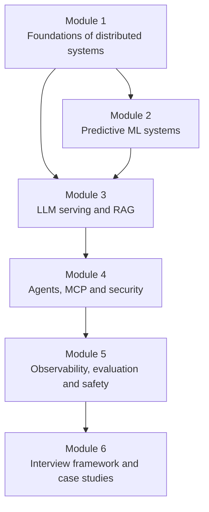

# Preface

**System Design in the AI Era (2026 Edition)**

Ten years ago, a "system design" round meant URL shorteners, news feeds and chat apps. Today, the same interview can ask you to design a customer-support agent, a document Q&A system with access control, or a gateway that serves an LLM to ten thousand teams. The old basics still matter. But now they sit next to GPUs, token budgets, vector search, tool calling and prompt injection.

This book connects both worlds. It starts with the fundamentals of distributed systems, then walks step by step into machine learning systems, LLM serving, RAG, agents, the Model Context Protocol (MCP), security, observability, evaluation and finally the interview itself.

## Who is this book for?

- **Software engineers** who build backend systems and now need to add AI features safely.
- **Students and early-career developers** who want a clear path from basics to modern AI architecture.
- **Interview candidates** preparing for system design rounds at product companies, startups and global teams.
- **Tech leads** who need a shared vocabulary to discuss AI systems with their teams.

You do not need a machine learning background. If you know what an API and a database are, you are ready.

## How the book is organised

*Figure: Each module builds on the one before it. Read in order, or jump to the module you need.*

| Module | What you will learn |
|---|---|
| 1. Foundations | Networking, storage, indexing, scalability and reliability |
| 2. Predictive ML systems | ML pipelines, feature stores, real-time inference |
| 3. Generative AI and RAG | How LLMs are served, and how retrieval makes them useful |
| 4. Agents and MCP | Agent architectures, tool access through MCP, security and identity |
| 5. Operations and safety | Monitoring, evaluation, guardrails and trust |
| 6. Interview masterclass | A repeatable framework and eight end-to-end designs |

## How to read it

Every chapter is split into **short concepts**. Each concept takes about five minutes or less, so you can finish one over a cup of chai. A typical page has:

1. A simple problem or analogy.
2. A plain explanation with a **diagram**.
3. Trade-offs, so you know when to use what.
4. A short **Key takeaways** box.

Every chapter ends with a recap, practice questions in interview style, and the sources used.

> [!TIP]
> Use the search box at the top (or press `S`) to find any term. Use the arrow keys to move between pages. Pick any theme from the paintbrush menu if the default does not suit your eyes.

## A note on accuracy

AI infrastructure changes fast. Every fact in this book was checked against official documentation, standards, research papers or engineering blogs, and the sources are listed at the end of each chapter. Wherever something is time-sensitive, the page says so. Numbers marked **Example** or **Assume** are for teaching only; they are not real-world measurements.

If you find a mistake or an outdated statement, please [open an issue or send a pull request](https://github.com/saurabhraj042/ai-system-design). Corrections make the book better for everyone.

Happy learning, and happy designing.

*Saurabh Raj*
