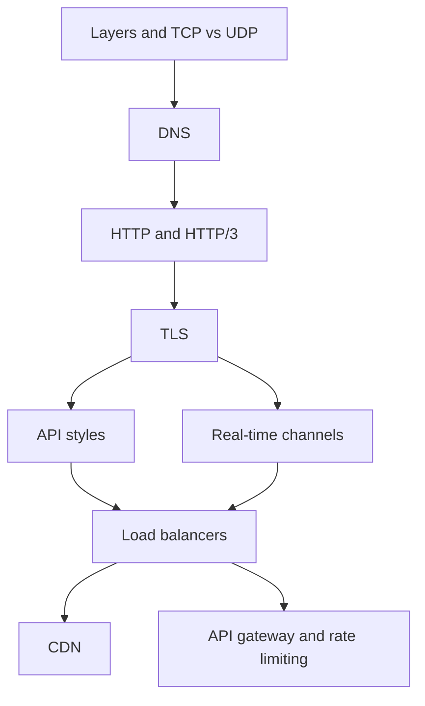

# Chapter 1: Core Network Protocols

Every AI system is a network system first. A user types a question in a chat app. The request crosses Wi-Fi, a mobile network, DNS, a load balancer and an API gateway. Only then does it reach a model, and the answer streams back, word by word.

If any hop is slow or broken, the user feels it. A fast GPU cannot fix a slow handshake or a badly placed server.

This chapter explains how bytes travel from one machine to another. You need this base for every later chapter. LLM streaming, MCP over HTTP, agent tool calls and RAG services all sit on top of these protocols.

*Figure: The path of a request, and the order of this chapter.*

## What you will learn

- **Network Layers**: OSI and TCP/IP models, and why layers help you debug.
- **TCP vs UDP**: reliable streams versus fast, loose datagrams.
- **DNS**: how a name like `example.com` becomes an IP address.
- **HTTP/1.1 to HTTP/3**: why each version exists, and what QUIC fixes.
- **TLS and HTTPS**: how a connection becomes private and trusted.
- **API Styles**: REST, gRPC and GraphQL, and when to pick each.
- **Real-Time Channels**: polling, SSE and WebSocket, and why LLM streaming uses SSE.
- **Load Balancers**: Layer 4 versus Layer 7, algorithms and health checks.
- **CDNs**: caching content close to users.
- **API Gateways and Rate Limiting**: the front door of your system, and the token bucket.
- **Recap and Practice**: key points, interview questions and sources.

Where a topic is covered in more depth elsewhere, we link to it. For example, [Chapter 6](../module-3/06-llm-serving.md) covers LLM serving, and [Chapter 9](../module-4/09-mcp.md) covers MCP transports.
