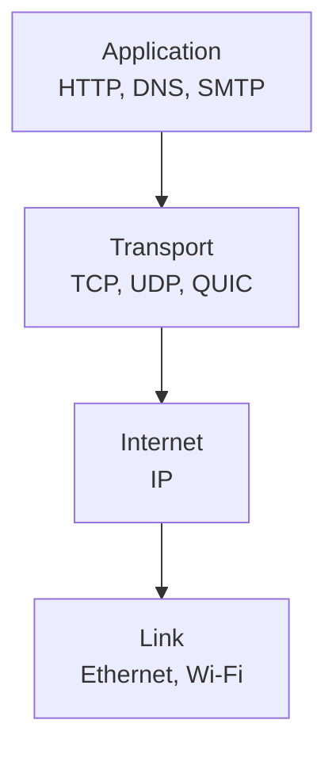

# Network Layers: OSI and TCP/IP

Think of sending a parcel by courier. You write the address, a packer boxes it, a truck moves it, and a delivery person hands it over. Each person does one job and trusts the next. Networks work the same way, in layers.

## What it is

A **layer** is a group of protocols that does one job and hides the details from the layers around it. Layering lets you change one part (say, Wi-Fi to fibre) without rewriting the rest (say, your web app).

Two models are used to explain this:

- **OSI model**: a reference model with 7 layers. It is mostly used for teaching and for vocabulary.
- **TCP/IP model**: the practical model of the internet. RFC 1122 (October 1989) describes four layers: link, internet, transport and application.

## How it works

*Figure: The four TCP/IP layers. Data moves down on the sender and up on the receiver.*

When your app sends data, each layer wraps it with its own header. This is called **encapsulation**. The receiver unwraps the headers in reverse order.

The OSI layers map roughly to the TCP/IP layers like this (the mapping is approximate):

| OSI layer | Name | TCP/IP layer | Example |
|---|---|---|---|
| 7 | Application | Application | HTTP, DNS |
| 6 | Presentation | Application | TLS, encoding |
| 5 | Session | Application | RPC, session set-up |
| 4 | Transport | Transport | TCP, UDP, QUIC |
| 3 | Network | Internet | IP |
| 2 | Data link | Link | Ethernet, Wi-Fi |
| 1 | Physical | Link | cables, radio |

Some protocols do not fit neatly. TLS is listed at layer 6 by some sources, but it runs on top of TCP and below HTTP. Do not worry about the exact box. Use the layers to ask the right question.

## Why engineers say "Layer 4" and "Layer 7"

In system design you will mostly hear two numbers:

- **Layer 4 (transport)**: sees IP addresses, ports and TCP/UDP connections. It does not read the HTTP request.
- **Layer 7 (application)**: understands HTTP. It can read the URL, headers and cookies.

A **Layer 4 load balancer** forwards connections fast. A **Layer 7 load balancer** can route `/chat` to one service and `/images` to another. You will meet both in the [Load Balancers](./08-load-balancers.md) page.

## Using layers to debug

When "the app is slow", walk down the layers:

1. **Application**: is the code or the model slow?
2. **Transport**: are connections being reset or retried?
3. **Internet**: is DNS wrong, or a route broken?
4. **Link**: is the Wi-Fi weak?

This habit saves hours in production.

> [!TIP]
> **Key takeaways**
> - A layer does one job and hides its details from the others.
> - The internet runs on the 4-layer TCP/IP model. OSI's 7 layers give us vocabulary.
> - "Layer 4" means connections and ports. "Layer 7" means HTTP-aware.
> - Debug by walking the layers one at a time.
