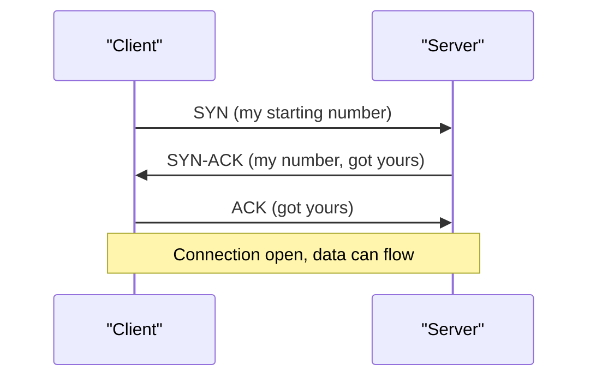

# TCP vs UDP

Sending a registered speed-post letter is slow but safe: you get a receipt, and lost letters are sent again. Shouting a message across a crowded railway platform is quick, but some words may be missed. TCP is the first. UDP is the second.

## What it is

Both protocols sit at the **transport layer**. They carry data between two programs, identified by IP address and **port** (a number that picks the program on that machine).

- **TCP (Transmission Control Protocol)**: a reliable, ordered stream of bytes. Defined in RFC 9293 (August 2022).
- **UDP (User Datagram Protocol)**: independent messages called datagrams, with very little overhead. Defined in RFC 768. The RFC states that delivery and duplicate protection are not guaranteed.

## How TCP works

Before any data moves, TCP does a **three-way handshake**.

*Figure: TCP three-way handshake. It costs one round trip before data.*

After that, TCP gives you these features (RFC 9293 and RFC 5681):

- **Sequence numbers and acknowledgements**: every byte is numbered. The receiver confirms what it got. Missing data is sent again.
- **Checksums**: corrupted segments are detected.
- **Flow control**: the receiver advertises a window, which says how much data it can accept. This stops a fast sender from flooding a slow receiver.
- **Congestion control**: the sender slows down when the network looks crowded. RFC 5681 describes slow start, congestion avoidance, fast retransmit and fast recovery. In slow start, the sending window starts small and grows quickly.

The result: your bytes arrive complete and in order, or the connection fails.

## How UDP works

UDP has an 8-byte header with source port, destination port, length and checksum. There is no handshake, no retransmission and no ordering. If a datagram is lost, UDP does not tell you.

Applications that use UDP add their own rules on top, or accept the loss.

## Trade-offs

| Point | TCP | UDP |
|---|---|---|
| Connection set-up | Handshake needed | None |
| Delivery | Reliable and ordered | Not guaranteed |
| Speed and overhead | More overhead | Very low overhead |
| Congestion control | Built in | Left to the application |
| Typical use | Web pages, APIs, databases, file transfer | DNS queries, QUIC, some real-time media |

## Head-of-line blocking

TCP delivers bytes in order. If one packet is lost, later packets must wait, even if they have arrived. This is called **head-of-line (HOL) blocking**. It matters a lot when many requests share one TCP connection. The [HTTP page](./04-http-evolution.md) shows how HTTP/3 avoids it by moving to QUIC, which runs on UDP.

## In the AI era

Most AI traffic is plain TCP, because model APIs run over HTTPS. A streamed LLM answer is a long-lived TCP connection. If that connection drops mid-answer, the client must handle it. Good clients retry or resume. [Chapter 3](../03-reliability.md) covers retries.

## Common mistakes

- Assuming "reliable" means "always delivered". TCP can still fail if the network is down. It only promises not to give you wrong or out-of-order data.
- Choosing UDP "for speed" without a plan for lost data.

> [!TIP]
> **Key takeaways**
> - TCP gives a reliable, ordered byte stream. The price is a handshake and head-of-line blocking.
> - UDP gives bare datagrams with no guarantees, so applications add their own rules.
> - TCP has flow control (receiver) and congestion control (network).
> - Newer protocols such as QUIC build reliability on top of UDP.
