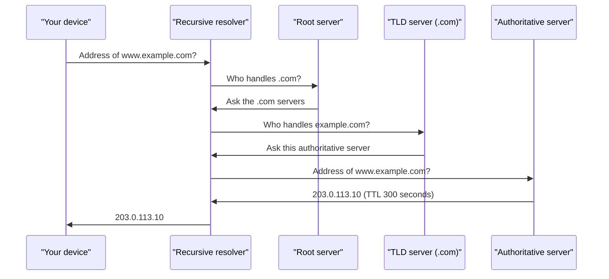

# DNS: The Internet's Phone Book

You save a friend as "Rahul" in your phone. You never remember his number. DNS does this for the internet. Humans use names like `example.com`. Machines need IP addresses.

## What it is

**DNS (Domain Name System)** is a distributed, hierarchical database that maps names to data, most often IP addresses. It was designed in RFC 1034 and RFC 1035 (1987).

A name is a series of labels separated by dots. It is read from right to left, like `www` . `example` . `com`. The tree starts at an invisible **root** at the top.

## How it works

Your phone does not know every domain. It asks a **recursive resolver** (often run by your ISP or a public provider). The resolver does the hard work and caches the result.

*Figure: A fresh lookup. The addresses are examples only.*

The steps:

1. The resolver asks a root server, which points to the **TLD** (top-level domain, such as `.com` or `.in`) servers.
2. The TLD servers point to the **authoritative server** of the domain. This server holds the real answer.
3. The resolver returns the answer and **caches** it.

Each record has a **TTL (time to live)**: how many seconds it may be cached. RFC 1035 says a TTL of zero means do not cache. The next user of the same resolver gets the answer instantly.

## Common record types

| Record | Meaning |
|---|---|
| A | Name to IPv4 address |
| AAAA | Name to IPv6 address |
| CNAME | This name is an alias for another name |
| NS | Which servers are authoritative for a zone |
| MX | Mail servers for the domain, with a preference order |

(A, CNAME, NS and MX are in RFC 1035. AAAA was added later for IPv6.)

## Transport

DNS queries normally use **UDP on port 53**. They are small, and a lost query can simply be retried. When answers are large, or for zone transfers, DNS uses TCP. **DNS over HTTPS (DoH, RFC 8484, October 2018)** carries queries inside HTTPS to protect privacy.

## DNS for system design

DNS is also a traffic tool. Managed DNS services, such as Amazon Route 53, offer routing policies like weighted, latency-based, failover and geolocation. So DNS can send users to the nearest region or move traffic away from a failed one.

The catch is caching. Resolvers hold old answers until the TTL ends. So a **low TTL** (for example 60 seconds) lets you switch traffic faster, but creates more DNS queries. A **high TTL** is cheaper but slower to change.

## Common mistakes

- Setting a very high TTL, then needing to move servers urgently.
- Forgetting that DNS is a dependency. If name lookup fails, your healthy servers still look down.
- Expecting DNS-based failover to be instant. Cached answers delay it.

> [!TIP]
> **Key takeaways**
> - DNS maps names to IP addresses through a hierarchy: root, TLD, authoritative.
> - Resolvers cache answers for the record's TTL.
> - DNS can steer traffic (weighted, latency, failover), but caching makes it slow to react.
> - Plain DNS uses UDP port 53. DoH hides queries inside HTTPS.
