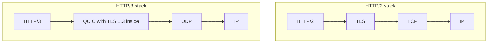

# HTTP/1.1 to HTTP/3 and QUIC

Imagine a small shop with one counter. Customers queue, and a slow customer holds everyone up. Each new HTTP version adds more counters and removes more queues.

## What it is

**HTTP (HyperText Transfer Protocol)** is the request-response protocol of the web and of most APIs. The meaning of methods, status codes and headers is the same in all versions (RFC 9110, "HTTP Semantics"). What changed is how messages are packed and carried on the wire.

## HTTP/1.1: text, one at a time

HTTP/1.1 (RFC 9112, June 2022 edition) sends human-readable text. Connections are persistent by default, so one TCP connection can serve many requests.

The problem: on one connection, responses must come back in request order. RFC 9112 allows pipelining (sending several requests without waiting), but responses still return in the same order. One slow response blocks those behind it. Browsers worked around this by opening several connections per host.

## HTTP/2: binary and multiplexed

HTTP/2 (RFC 9113, June 2022) keeps the same semantics and changes the wire format:

- **Binary frames**: every message is cut into frames with a fixed 9-byte header.
- **Multiplexing**: many **streams** share one connection. Each request-response pair is a stream, so a slow response does not block the others.
- **Header compression (HPACK)**: repeated headers such as cookies are sent in a short form.

But HTTP/2 still runs on TCP. The RFC itself says TCP head-of-line blocking is not addressed. If one TCP packet is lost, all streams wait.

## HTTP/3 and QUIC: no more TCP

HTTP/3 (RFC 9114, June 2022) carries the same semantics over **QUIC** (RFC 9000, May 2021). QUIC runs inside UDP datagrams and builds its own reliability, so the network sees plain UDP.

*Figure: HTTP/3 replaces TCP and the separate TLS layer with QUIC.*

What QUIC gives you:

- **Independent streams**: loss on one stream does not block the others. Order is guaranteed only within a stream.
- **Faster set-up**: QUIC combines the transport and TLS 1.3 handshakes into one. Clients that have talked to the server before can send data right away (0-RTT).
- **Connection migration**: a connection is identified by a connection ID, not just by IP and port. So it can survive a change of network path, for example after a NAT rebinding (a router changing the port it shows to the outside). In RFC 9000, only clients migrate.
- **QPACK**: HTTP/3's header compression, replacing HPACK because QUIC does not deliver everything in order.

## How a client finds HTTP/3

A client usually starts with HTTP/2 or HTTP/1.1. The server advertises HTTP/3 with an `Alt-Svc` header, for example `Alt-Svc: h3=":443"`. The client then tries QUIC on UDP. If UDP is blocked, it falls back to TCP.

## Comparison

| Point | HTTP/1.1 | HTTP/2 | HTTP/3 |
|---|---|---|---|
| Format | Text | Binary frames | Binary frames |
| Transport | TCP | TCP | QUIC over UDP |
| Requests per connection | One at a time in order | Many streams | Many streams |
| HOL blocking | At HTTP and TCP level | At TCP level | Per stream only |
| Header compression | None | HPACK | QPACK |

## What this means for you

- You rarely code against these versions. Your CDN, load balancer or web server speaks them for you.
- Many short requests (API calls, tool calls) gain most from HTTP/2 and HTTP/3.
- Users on changing networks may gain from QUIC connection migration.
- Check that your load balancer and CDN support HTTP/3. This varies by vendor.

> [!TIP]
> **Key takeaways**
> - HTTP semantics stay the same. Only the wire format and transport change.
> - HTTP/2 multiplexes streams on one TCP connection but still suffers TCP head-of-line blocking.
> - HTTP/3 uses QUIC over UDP: independent streams, faster handshake, connection migration.
> - Servers advertise HTTP/3 with Alt-Svc, and clients fall back to TCP if needed.
