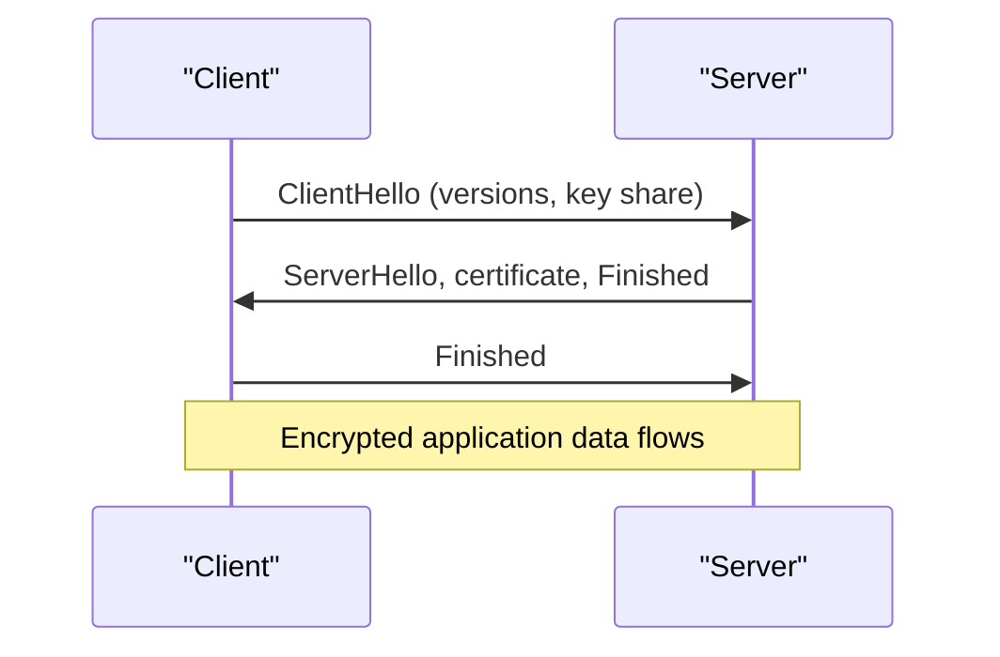

# TLS and HTTPS

When you pay through UPI, nobody on the Wi-Fi should read your PIN, change the amount, or pretend to be the bank. TLS gives you exactly these protections for any connection.

## What it is

**TLS (Transport Layer Security)** secures communication over an untrusted network. **HTTPS** is simply HTTP carried inside TLS. TLS 1.3 is defined in RFC 8446 (August 2018). MDN lists TLS 1.3 as the current and most widely used version, TLS 1.2 as still in use, and TLS 1.1 and 1.0 as no longer to be used.

It gives three things:

- **Confidentiality**: only the two ends can read the data.
- **Integrity**: tampering is detected.
- **Authentication**: the client can check it is talking to the real server. Client authentication is optional.

## How it works

At the start, client and server run a **handshake**. They agree on the version and a **cipher suite** (the set of algorithms), prove the server's identity, and create shared secret keys. After that, all data is encrypted with those keys.

*Figure: TLS 1.3 full handshake, simplified. The first flight already carries the client's key share.*

A normal TLS 1.3 handshake needs one round trip. (If the client's key share is unsuitable, a HelloRetryRequest adds one more.) It removed old, weak features. All key exchanges give **forward secrecy**, which means that stealing the server's key later does not reveal old recordings. Renegotiation and compression are gone.

## Certificates and trust

How does the client know the server is real? The server shows a **digital certificate**. It binds the server's public key to a domain name and is signed by a **Certificate Authority (CA)**. Browsers and operating systems ship with a list of CAs they trust. Let's Encrypt is one free, widely used CA.

Short lifetimes are becoming the norm. The CA/Browser Forum passed ballot SC-081v3, which cuts the maximum validity of public TLS certificates from 398 days to 47 days, in steps from March 2026 to March 2029 (as of November 2026). So you should **automate renewal**. Manual renewal will not survive.

## Two useful extras

- **ALPN (RFC 7301)**: during the handshake, client and server agree on the application protocol, such as HTTP/2 (`h2`) or HTTP/1.1. No extra round trip is needed.
- **HSTS**: a header that tells browsers to use HTTPS directly in future visits. It reduces the risk of an attacker blocking the upgrade to HTTPS.

## 0-RTT and its risk

TLS 1.3 lets a returning client send early data in its first flight, saving a round trip. The RFC warns that there are no guarantees of non-replay between connections. An attacker may replay that early data. So use 0-RTT only for requests that are safe to repeat, such as reading data. Do not use it for payments or other writes.

## Where TLS ends

In many designs, a load balancer or gateway **terminates TLS**: it decrypts the traffic and forwards it inside your network. This lets it read HTTP and route on it. Some teams re-encrypt traffic to the backend. Which to choose depends on your security needs. Layer 7 features need the traffic to be decrypted at that point.

## Common mistakes

- Letting a certificate expire. Use automatic renewal and alerts.
- Allowing old TLS versions "for compatibility".
- Enabling 0-RTT for non-repeatable requests.

> [!TIP]
> **Key takeaways**
> - TLS gives confidentiality, integrity and server authentication. HTTPS is HTTP over TLS.
> - TLS 1.3 needs one round trip and forces forward secrecy.
> - Certificates are signed by CAs. Lifetimes are shrinking, so automate renewal.
> - 0-RTT early data can be replayed. Use it only for safe requests.
