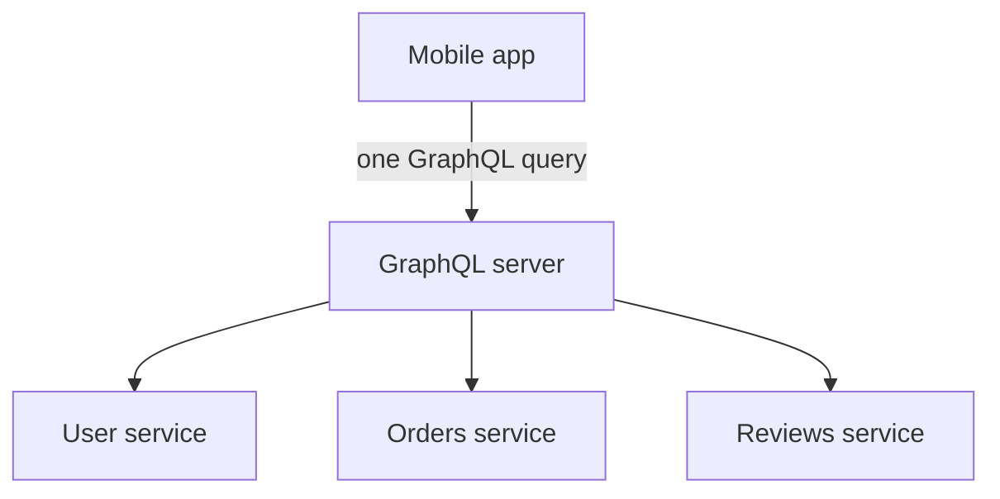

# API Styles: REST, gRPC and GraphQL

A restaurant can serve a fixed thali, a set menu delivered by a waiter's strict script, or a "make your own bowl" counter. All three feed you. They differ in who decides what you get. APIs are similar.

## What it is

An **API style** is a convention for how clients ask a server for data or actions. All three below run on top of HTTP, but they use it differently.

## REST

**REST (Representational State Transfer)** was described by Roy Fielding in his doctoral dissertation (2000). It is a set of constraints, not a protocol. The constraints are: client-server, stateless, cacheable, uniform interface, layered system, and optional code-on-demand.

In practice, you model things as **resources** with URLs and use HTTP methods:

| Method | Use | Safe | Idempotent |
|---|---|---|---|
| GET | Read | Yes | Yes |
| PUT | Replace | No | Yes |
| POST | Create or trigger action | No | No |
| PATCH | Partial update | No | No |
| DELETE | Remove | No | Yes |

*Idempotent* means repeating the call has the same effect as doing it once. This is why retries are safe for GET and PUT but risky for POST. See [Chapter 3](../03-reliability.md).

MDN notes that "RESTful" is often used loosely for any HTTP+JSON service. Because REST uses plain HTTP, it works well with caches, CDNs and browsers.

## gRPC

**gRPC** is a remote procedure call framework. You define a service in a **protocol buffers** file, and tools generate client and server code.

```text
service Weather {
  rpc GetForecast (CityRequest) returns (Forecast);
  rpc WatchAlerts (CityRequest) returns (stream Alert);
}
```

gRPC supports four call types: unary (one request, one response), server streaming, client streaming and bidirectional streaming. It also has **deadlines**: the client says how long it will wait, and the call fails with `DEADLINE_EXCEEDED` after that.

On the wire, each call is one HTTP/2 stream. The request is a POST to `/Service/Method`. Messages are length-prefixed binary, and the final status travels in HTTP/2 **trailers** (headers sent after the body). Binary messages are compact, and the typed contract catches mistakes early. It is a common choice for service-to-service calls.

## GraphQL

**GraphQL** is a query language and runtime for APIs. The server publishes a typed **schema**. The client asks for exactly the fields it needs and gets a response with the same shape.

```text
query {
  book(id: "1") {
    title
    author { name }
  }
}
```

Key points from graphql.org:

- Servers usually expose a **single endpoint**, such as `/graphql`. Queries and mutations use POST with a JSON body. GET is optional for queries only.
- A response can be HTTP 200 and still contain an `errors` list, so clients must check it.
- The **N+1 problem** appears when each item in a list triggers a separate database call. Batching (for example Facebook's DataLoader) fixes it.
- Operations are queries (read), mutations (write) and subscriptions (real-time).
- The latest spec release is September 2025.



*Figure: GraphQL can combine data from many backends into one response.*

## When to use what

| Need | Good fit |
|---|---|
| Public API, caching, simple tools | REST |
| Internal service-to-service, strict contracts, streaming | gRPC |
| Many client types needing different data shapes | GraphQL |

Mixing is normal. A company may use REST for public partners, gRPC inside and GraphQL for its mobile app.

## In the AI era

- LLM providers expose mostly JSON over HTTPS. Tool calls and structured outputs are JSON too.
- gRPC's streaming and deadlines suit internal inference services.
- Protocols for agents, such as MCP, define their own message format on top of HTTP or other transports. See [Chapter 9](../../module-4/09-mcp.md).

> [!TIP]
> **Key takeaways**
> - REST models resources with HTTP methods. It is simple and cache-friendly.
> - gRPC uses protobuf contracts and HTTP/2. It supports streaming and deadlines.
> - GraphQL lets clients pick fields from a single endpoint. Watch for N+1 and 200-with-errors.
> - Choose by consumer: public, internal or many-client.
