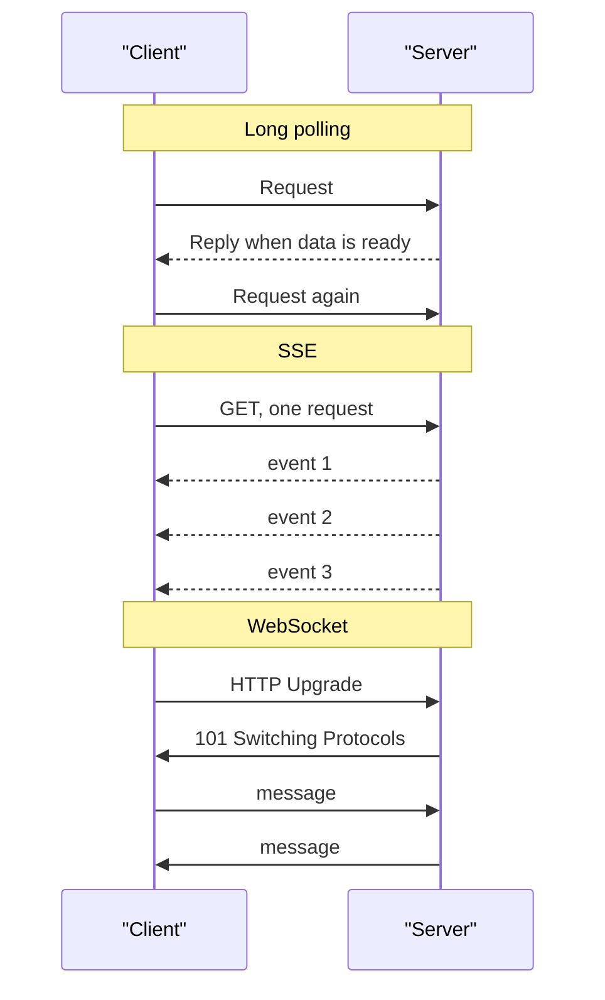

# Real-Time Channels: Polling, SSE and WebSocket

Watching a live cricket score, you can refresh the page every few seconds, or you can have the page update itself the moment a wicket falls. Plain HTTP is request-response: the client asks, the server answers. Real-time features need the server to talk first.

## What it is

Three common techniques let a server send updates to a client:

- **Long polling**: the client sends a request. The server holds it open until it has something to say, or a timeout. Then the client asks again (RFC 6202, 2011).
- **SSE (Server-Sent Events)**: one long HTTP response that the server keeps writing to. Data flows server to client only.
- **WebSocket**: a connection upgraded from HTTP to a two-way channel (RFC 6455, December 2011).

## How each works



*Figure: Three ways to push data. Only WebSocket is two-way after set-up.*

**Long polling** costs a full HTTP request and response, with headers, for every update. RFC 6202 notes that header overhead can dominate small messages.

**SSE** uses the `text/event-stream` content type. The stream is UTF-8 text, in lines such as:

```text
event: token
data: {"text": "Hello"}

data: next message
```

A blank line ends one event. The browser's `EventSource` reconnects on its own and sends a `Last-Event-ID` header, so the server can resume. Comment lines (starting with `:`) can keep idle connections alive through proxies. Over HTTP/1.x, browsers allow only 6 SSE connections per domain; over HTTP/2 the limit is the stream limit, 100 by default (MDN).

**WebSocket** starts with an HTTP GET carrying `Upgrade: websocket`. The server answers `101`. After that, both sides send frames at any time. It has ping and pong frames for keep-alive, and a close handshake. `wss://` is WebSocket over TLS.

## Which to choose

| Need | Long polling | SSE | WebSocket |
|---|---|---|---|
| Direction | Server push, simulated | Server to client | Both ways |
| Works over plain HTTP | Yes | Yes | Needs upgrade support |
| Auto-reconnect and resume | You build it | Built in | You build it |
| Best for | Fallback | Feeds, progress, token streams | Chat, games, collaboration |

## In the AI era: why LLM streaming uses SSE

An LLM produces text token by token, and users want to see it at once. The data flows one way: model to user. SSE fits: it is plain HTTP, so the usual HTTP tools, logs and load balancers work with it. The question goes in the request, and the answer comes back as an event stream.

Anthropic's Messages API streams with server-sent events when you set `"stream": true`. A stream starts with a `message_start` event, then content blocks with many `content_block_delta` events, and ends with `message_stop`. `ping` events may appear in between. Check each provider's docs for its exact event format.

Voice assistants or live collaboration, where audio or edits go both ways, may prefer WebSocket or other channels. Serving details are in [Chapter 6](../../module-3/06-llm-serving.md).

## Operating long-lived connections

- Proxies and load balancers may close idle connections, so send heartbeats.
- Each open connection holds server memory. Plan capacity for concurrent connections, not only requests per second.
- On reconnect, resume from the last event ID rather than starting over.

> [!TIP]
> **Key takeaways**
> - Long polling is a fallback. SSE is one-way push over HTTP. WebSocket is two-way.
> - SSE gives auto-reconnect and Last-Event-ID resume for free.
> - LLM token streaming is one-way, so SSE is a natural fit.
> - Long-lived connections need heartbeats and capacity planning.
