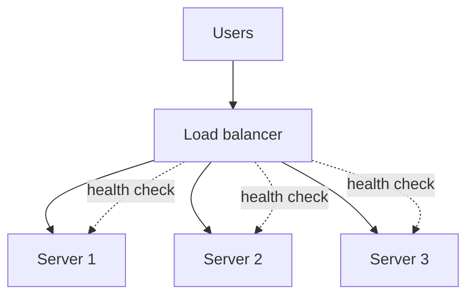

# Load Balancers: Layer 4 and Layer 7

At a busy railway station, one ticket counter would have a huge queue. So the station opens many counters, and a person at the entrance points you to a short line. A load balancer is that person.

## What it is

A **load balancer (LB)** sits in front of several servers and spreads incoming traffic across them. It gives you three things:

- **Scale**: add more servers behind it to handle more traffic.
- **Availability**: if a server fails, traffic goes to the others.
- **A single address**: clients talk to one name, not to every server.

## How it works

*Figure: The LB spreads requests and checks which servers are healthy.*

### Layer 4 vs Layer 7

| Point | Layer 4 (transport) | Layer 7 (application) |
|---|---|---|
| Sees | IP, port, TCP/UDP connection | Full HTTP request: path, headers, cookies |
| Speed | Very fast, little work per packet | More work, more features |
| Routing | By connection | By URL, host, header, method |
| Extra features | Static IP, long-lived connections | TLS termination, redirects, gRPC and HTTP/2 support, authentication |

AWS documents this split with its two products. The Network Load Balancer works at Layer 4 (TCP, UDP, TLS) and suits extreme performance or a static IP. The Application Load Balancer works at Layer 7 (HTTP, HTTPS, gRPC) and suits request-level routing. Other vendors have similar tools.

A typical design uses both: an L4 balancer at the edge for raw speed and fixed IPs, and L7 balancers or a gateway behind it for smart routing.

## Balancing algorithms

The nginx documentation lists these common methods:

- **Round robin**: take turns. This is nginx's default.
- **Weighted**: a server with weight 3 gets three requests for every one sent to a weight 1 server. Useful when servers differ in power.
- **Least connections**: send the next request to the server with the fewest active connections. Good when request times vary a lot.
- **IP hash**: the client's IP picks the server, so the same client usually lands on the same server.
- **Least time**: favours the server with the lowest response time and fewest connections.

## Health checks

An LB must stop sending traffic to a dead server.

- **Passive checks**: watch real traffic. In nginx, `max_fails` failures within `fail_timeout` mark a server as failed for a while.
- **Active checks**: the LB probes an endpoint regularly. AWS ALB health checks use HTTP, HTTPS or gRPC. NLB can also use plain TCP.

Make your health endpoint cheap. If it calls the database, a slow database can make every server look dead at once.

## Sticky sessions and state

Sticky sessions send a user back to the same server. They are a quick fix for apps that keep state in server memory. A better design is **stateless servers**, with state in a shared store. Then any server can handle any request. [Chapter 3](../03-reliability.md) goes deeper.

## In the AI era

LLM requests are long and uneven: one request may take 2 seconds and another 2 minutes. Round robin can pile slow requests on one server. "Least connections" is a better starting point. LLM-aware routing, which looks at queue length or cache hits, is covered in [Chapter 6](../../module-3/06-llm-serving.md).

Remember too that streaming responses keep connections open. Check the idle timeout on your LB, or it may cut a long answer in the middle.

> [!TIP]
> **Key takeaways**
> - A load balancer gives scale, availability and one address.
> - L4 is fast and simple. L7 understands HTTP and can route by path or header.
> - Round robin is the default. Use least connections when request times vary.
> - Health checks should be cheap. Long streams need generous idle timeouts.
