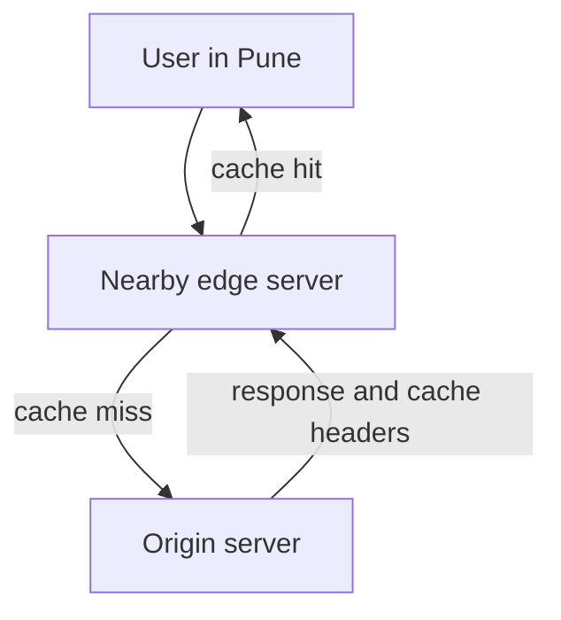

# CDNs: Content Closer to the User

A popular sweet shop opens branches in every city. You buy the same laddoo near your home, and the main kitchen is not overloaded. A CDN does this for your files.

## What it is

A **CDN (Content Delivery Network)** is a group of servers spread across many locations. Copies of your content are stored there, so each request is served by a server near the user. MDN lists the benefits: it offloads your own servers, lowers latency (distance affects latency), and comes with sensible cache settings.

Your own server is called the **origin**. The CDN servers close to users are called **edge** servers.

## How it works

*Figure: A hit is served from the edge. A miss goes to the origin once, then is stored.*

1. The user's request reaches a nearby edge server. The CDN decides which one.
2. **Cache hit**: the edge has a fresh copy and replies at once.
3. **Cache miss**: the edge fetches from the origin, stores a copy, and replies.

Some CDNs use **request collapsing**. If many identical requests arrive together, only the first goes to the origin. The rest wait for that one response. Cloudflare's docs describe this behaviour. It stops a flood of misses from crushing the origin.

## Who decides what is cached?

Your origin does, through HTTP **caching headers** (RFC 9111):

| Header or directive | Meaning |
|---|---|
| `Cache-Control: max-age=N` | Fresh for N seconds |
| `s-maxage=N` | Same, but for shared caches such as CDNs only. It wins over max-age there |
| `private` | Shared caches must not store it. Only the user's own browser may |
| `no-store` | Do not store any part of it |
| `no-cache` | May store, but must check with the origin before reuse |
| `Age` | How many seconds the copy has been cached |

The RFC also warns that `no-store` is not a reliable privacy mechanism. Do not depend on it to protect secrets.

CDNs have their own defaults and rules, which vary by vendor. For example, Cloudflare by default does not cache a response with `Set-Cookie`, or any method other than GET. It caches by file extension and does not cache HTML or JSON by default. Always read your CDN's rules.

## What belongs on a CDN

| Good fit | Poor fit |
|---|---|
| Images, CSS, JavaScript, fonts | Personalised pages |
| Videos and downloads | Responses with private user data |
| Public, rarely changing API responses | Writes (POST, PUT, DELETE) |

## Keeping content fresh

- **Versioned file names**: use `app.9f3a1c.js`. A new build gets a new name, so old copies never matter. Give such files a long max-age.
- **Short TTL** for content that changes often.
- **Purge**: ask the CDN to drop a copy. Most CDNs offer this, but the details vary.

## In the AI era

- Static front-end assets of an AI app (JavaScript, images) benefit like any other site.
- Personalised, streamed LLM answers are poor CDN candidates, because each is unique to one user and one question.
- Caching of repeated prompts and answers is done at other layers. See prompt and semantic caching in [Chapter 6](../../module-3/06-llm-serving.md).
- A CDN can also absorb traffic spikes for cacheable content, since a hit never touches your origin.

## Common mistakes

- Caching a response that has user-specific data and showing it to others.
- Forgetting versioning, then waiting for stale files to expire.
- Not checking the cache hit ratio. A CDN with a low hit ratio just adds a hop.

> [!TIP]
> **Key takeaways**
> - A CDN serves cached copies from edge servers near the user, which cuts latency and origin load.
> - The origin controls caching with Cache-Control headers. Use s-maxage for CDNs, private for user data.
> - Version static file names so you rarely need to purge.
> - Personalised LLM responses are not CDN material.
