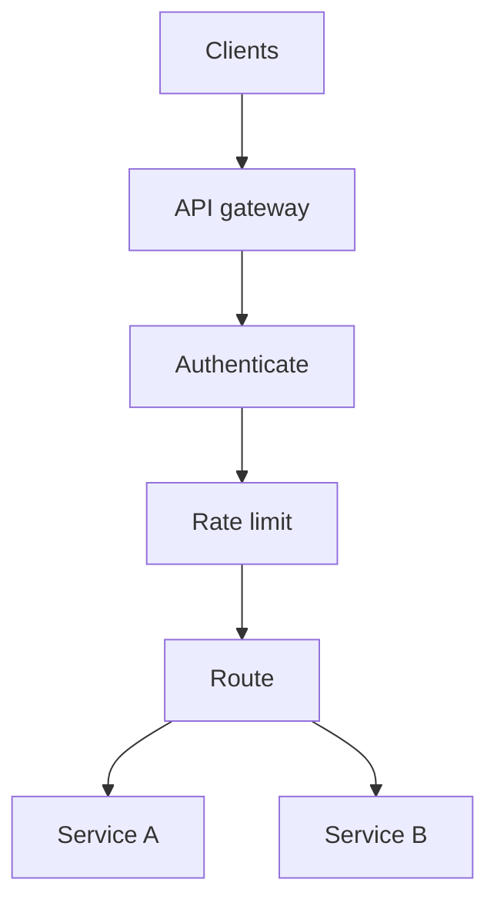
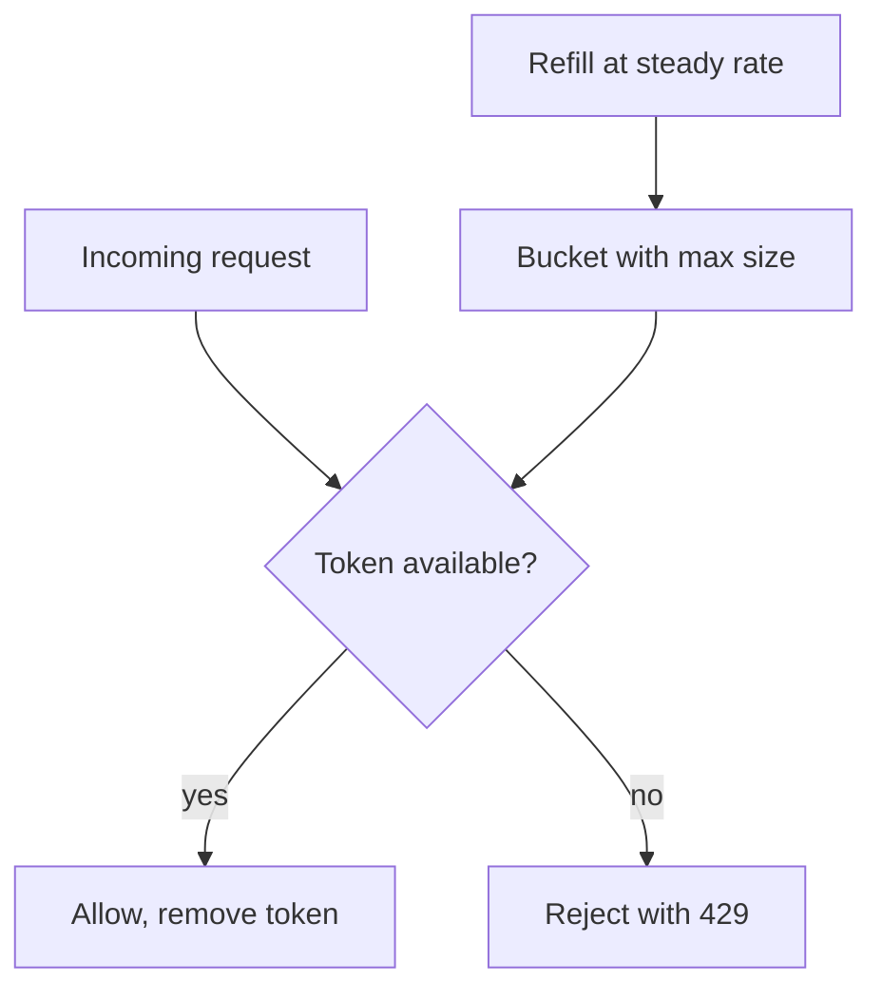

# API Gateways and Rate Limiting

A housing society has one gate with a guard. He checks who you are, notes your entry, and stops too many visitors at once. Your backend services should not each build their own gate. An API gateway is that one gate.

## What it is

An **API gateway** is a single entry point in front of your backend services. AWS describes its API Gateway as a "front door" that handles traffic management, authorisation and access control, monitoring and API version management. Other gateway products offer similar jobs. Features vary by product.

Common jobs of a gateway:

- **Authentication and authorisation**: check API keys or tokens before a request goes further.
- **Routing**: send `/users` to one service and `/orders` to another.
- **Rate limiting and quotas**: protect backends from overload and abuse.
- **TLS termination, logging and metrics**: one place for common work.
- **Versioning and canary releases**: send a small share of traffic to a new version.



*Figure: A request passes common checks once, at the gateway, before reaching a service.*

## Gateway, load balancer, CDN: who does what?

| Component | Main job |
|---|---|
| CDN | Cache and serve content near users |
| Load balancer | Spread traffic over copies of the same service |
| API gateway | Apply API policies and route to different services |

They often work together, and some products combine roles. The common order is CDN, then load balancer, then gateway, then services.

## Rate limiting

**Rate limiting** caps how many requests a client may make in a period. It protects your servers and keeps one heavy user from hurting others. When the limit is hit, the server replies **429 Too Many Requests**. RFC 6585 says the response may include a `Retry-After` header, telling the client how long to wait.

### The token bucket

A popular algorithm. AWS API Gateway and Anthropic's API both document that they use it.

- A bucket holds tokens, up to a maximum (the **burst**).
- Tokens are added at a steady **rate**.
- Each request takes one token. If the bucket is empty, the request is rejected.



*Figure: The token bucket allows short bursts but keeps the long-run rate steady.*

A simple version in Python:

```python
import time

class TokenBucket:
    def __init__(self, rate, burst):
        self.rate = rate          # tokens added per second
        self.burst = burst        # bucket size
        self.tokens = burst
        self.last = time.monotonic()

    def allow(self):
        now = time.monotonic()
        self.tokens = min(self.burst, self.tokens + (now - self.last) * self.rate)
        self.last = now
        if self.tokens >= 1:
            self.tokens -= 1
            return True
        return False
```

Anthropic's docs note that this means capacity is replenished continuously, not reset at fixed intervals. In a **fixed window** counter (for example, "100 per minute, counted from :00"), a client could send 100 requests at 12:00:59 and 100 more at 12:01:00. The bucket smooths this.

### Who is limited?

Choose a **key**: API key, user ID, tenant or IP address. AWS usage plans limit per API key. You can also set limits per route, because an expensive endpoint needs a lower limit than a cheap one.

In a multi-server gateway, the counters must be shared (often in a fast store such as Redis) or split among servers. Shared counters are more exact but add latency. Split counters are faster but less exact. Pick based on how strict the limit must be.

### Telling clients about limits

The IETF has an Internet-Draft, `draft-ietf-httpapi-ratelimit-headers` (version 11, May 2026), for `RateLimit` and `RateLimit-Policy` headers. It is still a draft, not a final standard. Many providers use their own header names. Anthropic, for example, returns `anthropic-ratelimit-*` headers and `retry-after`.

## In the AI era

LLM calls cost real money and GPU time, so request count alone is a weak limit. Anthropic's API measures requests per minute, input tokens per minute and output tokens per minute. A gateway in front of models often limits by **tokens** or by spend, per team or per user. This is the idea behind an LLM gateway, covered in [Chapter 6](../../module-3/06-llm-serving.md).

Clients should respect `Retry-After` and use exponential backoff with jitter. See [Chapter 3](../03-reliability.md).

> [!TIP]
> **Key takeaways**
> - An API gateway is the single front door: auth, routing, limits, logs and versioning.
> - Rate limiting protects backends. Reject with 429 and, if possible, a Retry-After header.
> - The token bucket allows bursts but holds a steady average rate.
> - For LLM APIs, limit by tokens and spend, not only requests.
