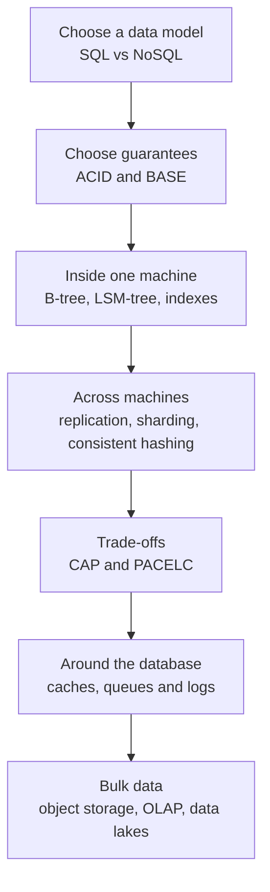

# Chapter 2: Data Storage & Indexing

Every AI system is a data system first. A chat assistant stores conversations. A recommendation engine reads millions of user events. A RAG pipeline keeps documents, chunks and metadata. An agent saves its state between steps. If the storage layer is slow, wrong or too costly, the smartest model cannot save you.

This chapter gives you the storage toolkit that every later chapter uses. You will learn how a database keeps data safe, how it finds one row among billions, how it survives machine failures, and how it grows beyond one machine. You will also see where caches, queues, object storage and data lakes fit in.

Vector databases are not covered here. They have their own home in [Chapter 7](../module-3/07-rag-architectures.md). For failure handling and scaling, see [Chapter 3](03-reliability.md).

*Figure: The map of this chapter, from one database to a full data platform.*

## What you will learn

- **SQL vs NoSQL**: how to pick a data model without following hype.
- **ACID and BASE**: what "safe" means for a transaction, and when you can relax it.
- **B-tree vs LSM-tree**: the two main ways a database stores data on disk.
- **Indexes**: how to make reads fast, and what each index costs you.
- **Replication**: copies of data for availability and read scale.
- **Sharding and consistent hashing**: splitting data across machines without chaos.
- **CAP and PACELC**: the trade-offs when a network fails, and even when it does not.
- **Caching**: patterns, invalidation and the bugs they bring.
- **Queues and logs**: moving data between systems, Kafka-style.
- **Object storage, OLAP and data lakes**: where the big, cheap data lives.
- **Recap and practice**: revision points and interview questions.
