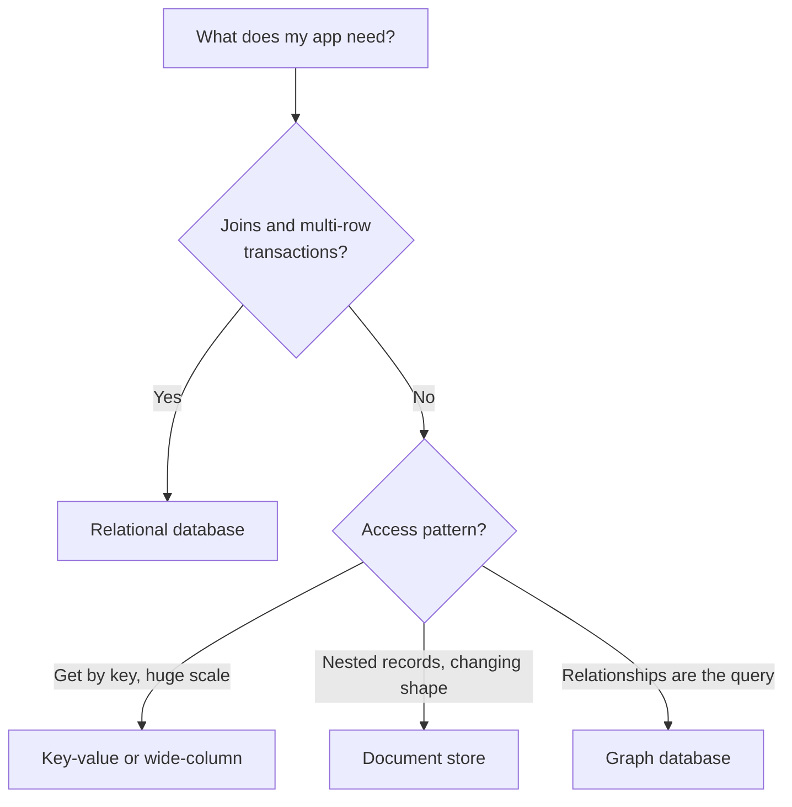

# SQL vs NoSQL

Think of two ways to keep records. One is a well-organised register with fixed columns, where every entry looks alike. The other is a box of folders where each folder can hold different papers. Both work. Each is good for different jobs.

## What it is

A **relational (SQL) database** stores data in tables made of rows and columns. A schema (the fixed structure of tables and columns) is defined up front. You link tables with keys and combine them with joins. You query using SQL. PostgreSQL and MySQL are well-known examples.

**NoSQL** means "not only SQL". It is a loose name for databases that do not use the classic relational model. They come in a few families.

| Family | Data shape | Typical use | Examples |
|---|---|---|---|
| Key-value | One key maps to one value | Sessions, carts, caches | Redis, Memcached |
| Document | JSON-like documents | Product catalogues, user profiles | MongoDB |
| Wide-column | Rows with flexible columns, grouped by key | Huge write volumes, time series | Cassandra |
| Graph | Nodes and relationships | Social links, fraud rings | Neo4j |

Some products fit more than one family, so treat the table as a rough guide.

## How it works

The real difference is how you design.

- In SQL, you model the **data first**, normalise it (store each fact once), and let joins answer any question later.
- In most NoSQL stores, you model the **queries first**. You decide how the app will read the data, then shape the data to make exactly those reads cheap.

*Figure: A simple decision path. Real choices also depend on team skills and cost.*

## Trade-offs

| Point | SQL | NoSQL (general trend) |
|---|---|---|
| Schema | Fixed, enforced by the database | Flexible, often enforced by app code |
| Joins | Built in | Limited or absent; data is often copied instead |
| Transactions | Strong support across many rows | Varies by product; check the docs |
| Scaling writes | Easy on one machine, harder across many | Often designed to spread across many machines |
| Ad-hoc questions | Very good | Weak if you did not plan the query |

"NoSQL scales, SQL does not" is too simple. A single well-tuned relational database handles a lot of traffic. Sharding it is harder work, but possible. The next pages explain how.

## In the AI era

AI apps often need both. Chat history and user accounts fit a relational table. Raw LLM outputs, tool results and agent state are JSON-shaped, so they fit documents or JSON columns. Embeddings need vector search, which is covered in [Chapter 7](../../module-3/07-rag-architectures.md). A common, sensible start is one relational database with a JSON column, and a new store only when a real limit appears.

## Common mistakes

- Picking NoSQL because it sounds modern, then needing joins and transactions later.
- Picking one database for every job, even when the access pattern is very different.
- Skipping the access-pattern list. In NoSQL, a wrong key choice is expensive to fix.

> [!TIP]
> **Key takeaways**
> - SQL models data first and asks questions later. Most NoSQL models the queries first.
> - NoSQL has four main families: key-value, document, wide-column and graph.
> - Start with the simplest store that meets your access patterns. Add another only for a proven need.
