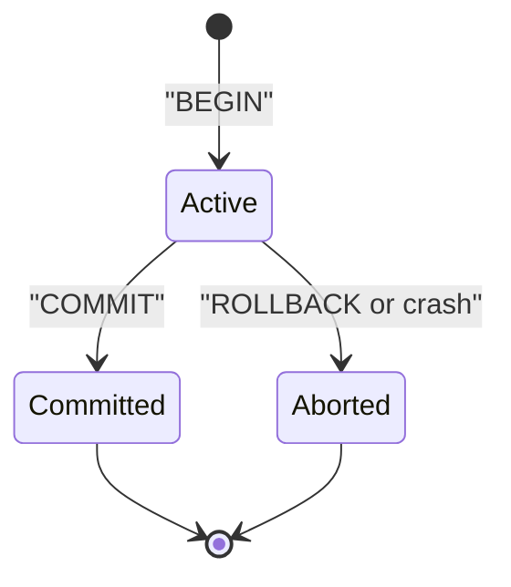

# ACID and BASE

You send Rs 5,000 on UPI. Your account is debited. What if the app crashes before the other person is credited? Money cannot vanish. Databases handle this with transactions.

## What it is

A **transaction** is a group of operations that the database treats as one unit. **ACID** describes four promises a transaction gives you.

| Letter | Promise | Bank transfer example |
|---|---|---|
| **A**tomicity | All or nothing | Debit and credit both happen, or neither does |
| **C**onsistency | Rules stay true after the transaction | Total money is unchanged; no negative balance if the rule forbids it |
| **I**solation | Concurrent transactions do not see each other's half-done work | A balance report never shows the debit without the credit |
| **D**urability | Once committed, it stays committed | A crash after "success" does not undo the transfer |

The PostgreSQL tutorial uses this same kind of transfer to explain atomicity, isolation and durability.

## How it works

Durability usually comes from a **write-ahead log (WAL)**. The database writes a record of the change to a sequential log on disk before it changes the main data files. After a crash, it replays the log. PostgreSQL documents exactly this idea.

*Figure: A transaction ends in exactly one of two states. Aborted means no change is visible.*

### Isolation levels

Full isolation is costly, so databases offer levels. PostgreSQL (current documentation, version 18) has three real levels, and its default is **Read Committed**.

| Level | What you get | What you must handle |
|---|---|---|
| Read Committed (default) | Each statement sees only committed data | Two reads in one transaction can differ |
| Repeatable Read | One stable snapshot for the whole transaction | Retry on serialisation errors |
| Serializable | Behaves as if transactions ran one by one | Retry on serialisation errors |

Other databases name and implement levels differently. Always read your database's documentation.

## BASE: the relaxed cousin

Some systems give up strict guarantees to stay available and fast across many machines. **BASE** is the name for this style: **B**asically **A**vailable, **S**oft state, **E**ventually consistent. Dan Pritchett described it in ACM Queue in 2008.

*Eventually consistent* means copies may differ for a short time, but they converge if no new writes arrive.

Amazon's Dynamo paper gives a clear example. A shopping cart must never lose an "add to cart", even during failures. So Dynamo keeps divergent versions of a cart and merges them later. Availability is chosen over a single perfect view.

## When to use what

| Need | Lean towards |
|---|---|
| Money, inventory, bookings, anything that must be exact | ACID transactions |
| Likes, view counts, feeds, carts where a brief mismatch is fine | BASE-style, eventual consistency |
| Mixed system | ACID for the core ledger, BASE for the read-heavy edges |

It is not a strict either-or. DynamoDB, for example, reads with eventual consistency by default. You can ask for a strongly consistent read per request, and an eventually consistent read costs half as much (AWS documentation).

## In the AI era

Agents call tools that change the world: book a ticket, send a payment. If an agent retries a step after a timeout, you may run the action twice. Transactions and idempotency (making a repeated request safe) matter more, not less. [Chapter 3](../03-reliability.md) covers idempotency.

> [!TIP]
> **Key takeaways**
> - ACID: atomicity, consistency, isolation, durability. Use it where wrong data is costly.
> - BASE trades strict consistency for availability and speed. Copies converge over time.
> - Stronger isolation costs performance. Know your database's default level.
