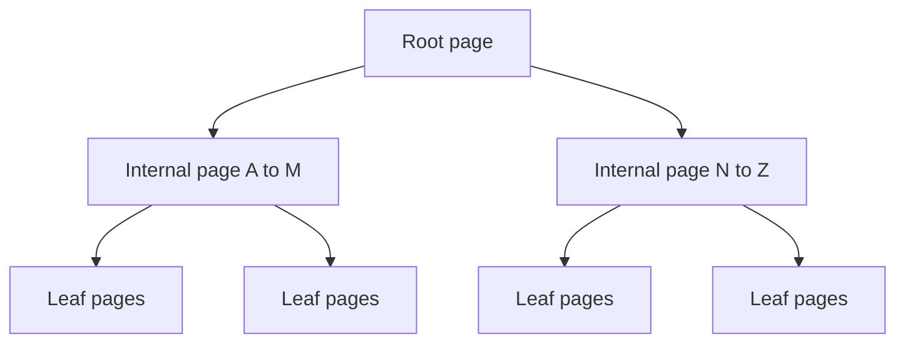
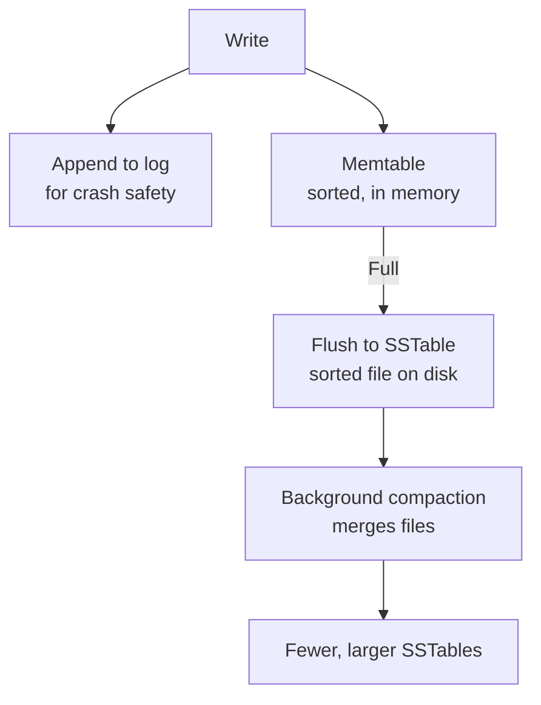

# B-Tree vs LSM-Tree

A database must keep data on disk and still find one record fast. There are two main designs. One keeps data sorted in place. The other writes fast first and tidies up later.

## What it is

A **storage engine** is the part of a database that decides how bytes are laid out on disk. Two families dominate.

- **B-tree**: a balanced tree of fixed-size pages. Data stays sorted, and updates change pages in place.
- **LSM-tree** (log-structured merge-tree): writes go to memory and to a log, then are flushed to sorted, immutable files. Background jobs merge those files. The idea comes from a 1996 paper by O'Neil and co-authors.

## How a B-tree works

PostgreSQL's default index is a B-tree. Its documentation describes a balanced, page-based tree: a root, internal pages with pointers down, and leaf pages that point to table rows. When a page fills up, it splits, and splits can ripple upward.

*Figure: A lookup walks from the root to one leaf. Each page holds many keys, so the tree stays shallow.*

Reads are predictable: a few page reads. Range scans are good because leaves are in sorted order. Writes update pages in place, so a random write may touch a random place on disk.

## How an LSM-tree works

RocksDB and Cassandra both document this path.

*Figure: LSM write path. Writes are sequential, which is cheap on disk.*

- The **memtable** is a sorted structure in memory.
- An **SSTable** (sorted string table) is an immutable sorted file.
- **Compaction** merges files and drops overwritten and deleted keys. Cassandra notes this rewriting causes **write amplification**: one logical write becomes several physical writes over time.
- A read may need to check the memtable and several files. **Bloom filters** (small structures that quickly say "this key is definitely not here") help skip files.

## Trade-offs

| Point | B-tree | LSM-tree |
|---|---|---|
| Write speed | Good; random in-place writes | Very good; sequential appends |
| Read speed | Steady, few page reads | May check many files; filters help |
| Range scans | Excellent | Good, after merging |
| Background work | Little | Compaction uses CPU and disk |
| Space use | Some wasted space in pages | Old versions linger until compaction |
| Seen in | PostgreSQL index default | RocksDB, Cassandra |

Neither is better in general. LSM-trees suit write-heavy loads such as logs, events and time series. B-trees suit mixed loads with many reads and in-place updates.

## In the AI era

Event streams, telemetry and agent traces are write-heavy and append-like, so LSM-based stores are common there. User-facing lookups over accounts and orders still lean on B-tree indexes. A single product often uses both, in different places.

## Common mistakes

- Choosing an engine from a benchmark you did not run on your own data shape.
- Forgetting compaction cost. A busy LSM store can slow down while it catches up.

> [!TIP]
> **Key takeaways**
> - B-tree: sorted pages updated in place. Predictable reads and great range scans.
> - LSM-tree: memory plus log, then immutable sorted files merged in the background. Fast writes.
> - The price of LSM is compaction and write amplification. Pick by your read/write mix.
