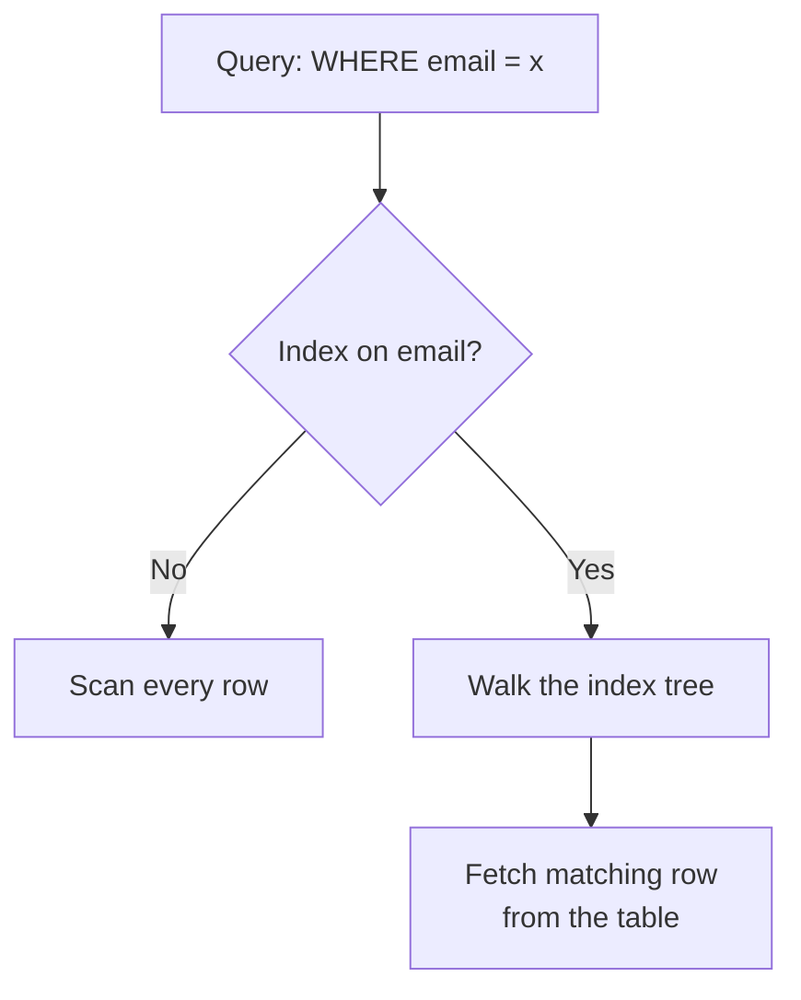

# Indexes

To find one topic in a thick textbook, you do not read every page. You open the index at the back. Databases do the same.

## What it is

An **index** is an extra structure that helps the database find rows without scanning the whole table. Without one, a query like `WHERE email = 'a@b.com'` reads every row (a full or sequential scan). With a good index, it jumps close to the answer.

The price is simple: indexes take space, and every insert, update or delete must also update them. Indexes speed up reads and slow down writes.

## How it works

PostgreSQL creates a B-tree index by default. It supports `<`, `<=`, `=`, `>=`, `>`, plus `BETWEEN` and `IN`, and it can return rows in sorted order.



*Figure: An index turns a scan of all rows into a short walk plus a fetch.*

### Index types (PostgreSQL)

| Type | Good for |
|---|---|
| B-tree | Equality and ranges on sortable data (the default) |
| Hash | Equality only |
| GIN | Values with many parts, such as arrays |
| GiST, SP-GiST | Geometric and other special data |
| BRIN | Huge tables where values follow physical row order |

Other databases have similar ideas under different names.

### Useful patterns

**Multicolumn index.** Order matters. An index on `(city, age)` helps queries that constrain `city` first. PostgreSQL's documentation says such an index is most efficient when conditions constrain the leftmost columns. A query on `age` alone usually cannot use it well.

**Covering index.** If the index holds every column the query needs, the database can skip the table. PostgreSQL calls this an index-only scan, and `INCLUDE` adds extra payload columns:

```sql
CREATE INDEX orders_user_idx ON orders (user_id) INCLUDE (status);

SELECT status FROM orders WHERE user_id = 42;
```

This works best on tables where rows rarely change, because PostgreSQL must check a visibility map for each page.

**Partial index.** Index only the rows you search for:

```sql
CREATE INDEX orders_unbilled_idx ON orders (order_nr)
    WHERE billed IS NOT TRUE;
```

It is smaller and cheaper to maintain.

## Trade-offs

| Benefit | Cost |
|---|---|
| Fast point lookups and ranges | Slower writes |
| Sorted output without a sort step | Extra disk and memory |
| Can enforce uniqueness | More indexes mean more to maintain |

## In the AI era

Metadata filters in AI apps (tenant id, document type, date) still need normal indexes. Vector similarity search needs special index types, which [Chapter 7](../../module-3/07-rag-architectures.md) explains. Do not use a normal B-tree for "nearest meaning" queries.

## Common mistakes

- Indexing every column "just in case". Each one slows writes.
- Expecting `LIKE '%shirt'` to use a B-tree. PostgreSQL can use it only when the pattern is anchored at the start, like `'shirt%'`.
- Getting multicolumn order wrong.
- Never checking the query plan. Run `EXPLAIN` to see whether your index is used.

> [!TIP]
> **Key takeaways**
> - An index trades slower writes and more space for faster reads.
> - For multicolumn indexes, column order matters: leftmost columns first.
> - Covering and partial indexes cut work further. Always verify with the query plan.
