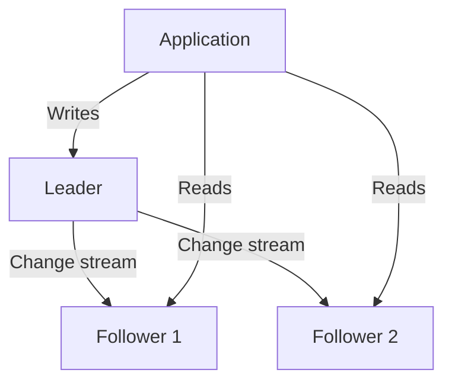
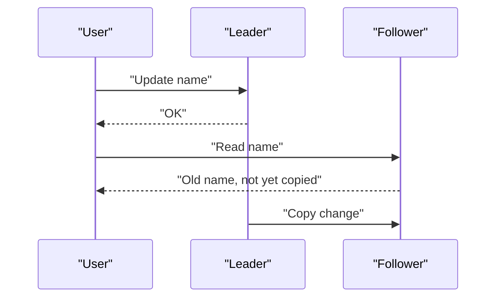

# Replication

A railway ticket chart is printed in many copies and pasted on many platforms. If one copy is torn, passengers still find their seat. Replication keeps copies of data on several machines for the same reason.

## What it is

**Replication** means keeping copies of the same data on more than one machine. It gives you:

- **Availability**: if one machine dies, another can serve.
- **Durability**: data survives a disk or machine loss.
- **Read scale**: many machines can answer reads.
- **Lower latency**: a copy can sit closer to users.

## How it works

The most common design is **leader-follower** (also called primary-standby). PostgreSQL's documentation uses "primary" for the one server that accepts writes, and "standby" for servers that follow it. Standbys do not take writes from clients. A **hot standby** accepts read-only queries. A warm standby cannot be connected to until it is promoted.

*Figure: Writes go to the leader. Followers copy changes and serve reads.*

### Synchronous or asynchronous

| Mode | Commit waits for the follower? | Failover can lose data? | Speed |
|---|---|---|---|
| Synchronous | Yes | No | Slower, especially over long distances |
| Asynchronous | No | Yes, recent commits may be lost | Faster |

PostgreSQL warns that a fully synchronous setup over a slow network can cut performance by more than half. In PostgreSQL, `synchronous_standby_names` lists the standbys that must confirm.

### Replication lag

With asynchronous copies, a follower is slightly behind. This is **replication lag**. A user updates their profile, refreshes, hits a follower, and sees the old value. That feels like a bug.

*Figure: Reading from a lagging follower right after a write.*

Common fixes: read your own recent writes from the leader, or pin a user to the leader for a short time after a write.

## Other designs

- **Multi-leader**: several leaders accept writes, often one per region. Conflicts must be resolved.
- **Leaderless**: any replica accepts writes. Dynamo uses N replicas per key. A write needs W acknowledgements and a read asks R replicas. If R + W > N, the read and write sets overlap, which gives a quorum-like system. The Dynamo paper says the common (N, R, W) setting in its instances is (3, 2, 2).

## Trade-offs

| Design | Strength | Pain |
|---|---|---|
| Leader-follower | Simple, easy to reason about | Single write point; failover needs care |
| Multi-leader | Writes close to each region | Conflict handling |
| Leaderless | No single point of failure | Divergent copies; app-level repair |

## In the AI era

Read replicas are a natural place to run heavy analytical or retrieval queries without hurting live traffic. Agent memory stores need clear rules: should an agent always see its own last write? If yes, route reads accordingly.

## Common mistakes

- Treating a follower as always current.
- Forgetting that failover itself needs testing.

> [!TIP]
> **Key takeaways**
> - Replication gives availability, durability and read scale.
> - Async replication is fast but can lose recent writes and show stale reads.
> - Quorums (R + W > N) are the leaderless way to keep reads and writes overlapping.
