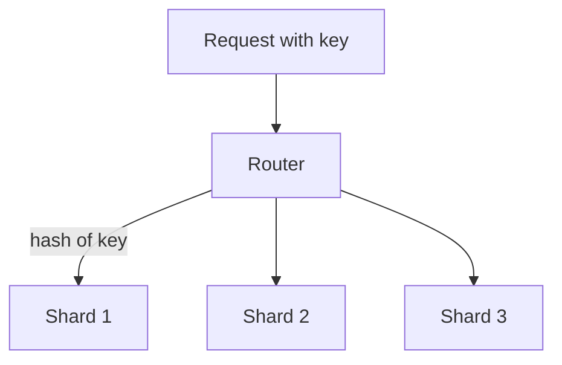
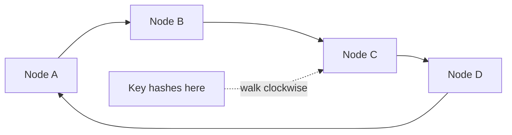

# Sharding and Consistent Hashing

One godown cannot hold all the goods of a growing business. You open more godowns and need a rule: which item goes where, and what changes when you open a new one?

## What it is

**Partitioning** means splitting one big table into smaller pieces. **Sharding** is partitioning across different machines, so each machine (a shard) holds only part of the data. Replication copies the same data. Sharding splits different data.

PostgreSQL's built-in partitioning supports range, list and hash methods. It gives you **partition pruning** (the planner skips pieces that cannot match) and fast removal of old data by dropping a partition. Its partitions are normally tables in the same database. Spreading data over many servers needs more tooling.

## How it works

You pick a **shard key**, a column or field. A rule maps each key to a shard.

| Strategy | Rule | Good | Watch out |
|---|---|---|---|
| Range | Key ranges, such as dates or A to M | Range scans stay on few shards | Hotspots when keys grow steadily |
| Hash | Hash of the key picks the shard | Even spread | Range queries touch many shards |

MongoDB documents this clearly. Hashed sharding spreads documents evenly and does not pile new inserts on one shard when keys like timestamps keep increasing. The cost is that range queries often must go to all shards.

*Figure: A router maps each key to its shard.*

## The problem with simple hashing

The easy rule is `shard = hash(key) mod N`. It breaks when N changes.

*Example (assume uniform keys):* going from 4 servers to 5, a key stays only if `k mod 4` equals `k mod 5`. That is true for about 20% of keys. Around 80% must move. Moving that much data is slow and can overload the system.

## Consistent hashing

Karger and colleagues introduced **consistent hashing** in 1997 for web caching. Roughly, a consistent hash changes minimally as the set of machines changes. Dynamo's description is easy to follow:

1. Treat the hash output range as a **ring** (the largest value wraps to the smallest).
2. Give each node a position on the ring.
3. Hash a key to a position. Walk **clockwise** to the first node. That node owns the key.

*Figure: The ring. A key belongs to the next node clockwise from its position.*

When a node joins or leaves, only its neighbour's range is affected. Other nodes keep their keys.

Basic random positions give uneven load. Dynamo fixes this with **virtual nodes**: each physical node takes many positions ("tokens") on the ring. If a node fails, its load spreads over the others. A new node takes a roughly equal share from many nodes. A stronger machine can hold more virtual nodes.

## Trade-offs

- **Cross-shard queries** are slow. Joins and transactions across shards are hard.
- **Hot keys** can overload one shard even with a good hash, for example one very popular user.
- **Resharding** is real operational work, even with consistent hashing.
- **Shard key choice** is hard to undo. Pick it from your main query pattern.

## In the AI era

Multi-tenant AI products often shard by tenant id, so one customer's chats and documents stay together. Watch for a "whale" tenant who becomes a hot shard.

> [!TIP]
> **Key takeaways**
> - Sharding splits data across machines. The shard key decides everything.
> - `hash mod N` moves most keys when N changes. Consistent hashing moves only a neighbour's share.
> - Virtual nodes balance load. Cross-shard queries and hot keys remain the main pain.
