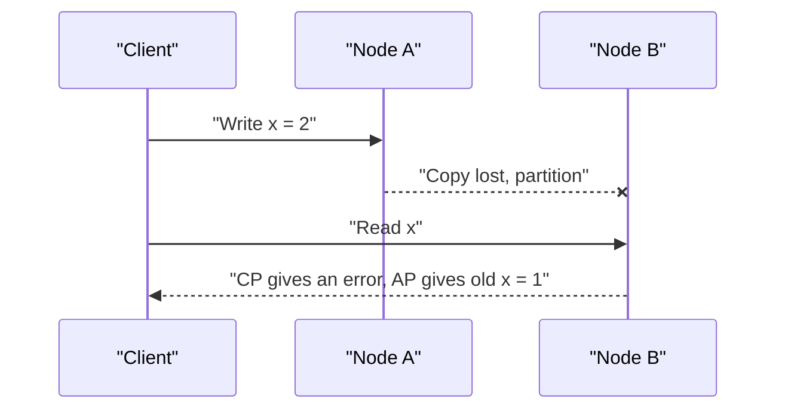
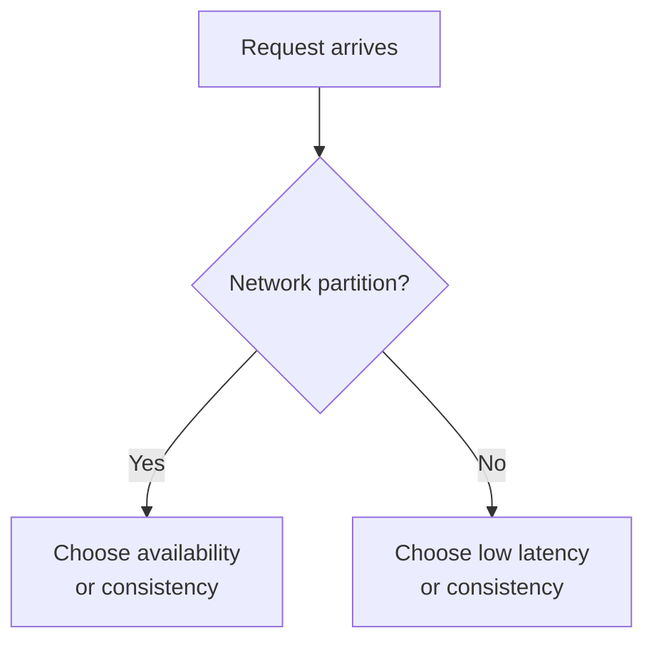

# CAP and PACELC

Two bank branches share one ledger over a phone line. The line is cut. A customer asks branch B for a balance that branch A just changed. Branch B can refuse to answer, or answer with an old number. There is no third option. This is the heart of CAP.

## What it is

The **CAP theorem** was proved by Gilbert and Lynch (2002) for Eric Brewer's conjecture. Its three words have precise meanings in that paper:

- **Consistency**: atomic, also called linearizable. The system behaves as if there is one copy of the data, and every read sees the latest write. This is narrower than the "C" in ACID.
- **Availability**: every request to a non-failing node gets a response.
- **Partition tolerance**: the system keeps working even when the network loses messages between nodes.

The result: when a network partition happens, you cannot have both consistency and availability.

## How it works

Networks do fail, so for a distributed system the real choice is what to give up **during a partition**.

*Figure: During a partition, node B must either refuse (consistent) or answer with stale data (available).*

| Choice | During a partition | Good for |
|---|---|---|
| CP | Some requests fail or wait | Money, locks, leader election |
| AP | Requests succeed, data may be stale and merged later | Carts, feeds, counters |

## Brewer's own correction

In 2012 Brewer wrote that the "2 of 3" slogan is misleading. His points:

- Partitions are rare, so do not give up consistency or availability when there is no partition.
- The choice can differ by operation, data or user within one system.
- Handle partitions in three steps: detect, enter a partition mode that limits some operations, then recover and fix mistakes.

## PACELC: the missing half

Daniel Abadi extended CAP in a 2012 paper. **PACELC** reads:

*If there is a Partition (P), choose Availability (A) or Consistency (C). Else (E), choose Latency (L) or Consistency (C).*

Even on a healthy network, waiting for several replicas to agree takes time. So fast systems often answer from a nearby copy and accept a risk of stale data. This gives four classes: PA/EL, PA/EC, PC/EL and PC/EC. Public summaries of Abadi's paper list Dynamo and Cassandra as PA/EL, and Bigtable/HBase as PC/EC. Treat such labels with care. Many products are tunable.

DynamoDB shows the tuning. Reads are eventually consistent by default, with a per-request strongly consistent option. Its global tables offer two modes: multi-Region eventual consistency (the default) or multi-Region strong consistency, where a write is copied synchronously to another Region before it returns.

*Figure: PACELC in one picture.*

## Common mistakes

- Saying "we pick CA". A distributed system cannot ignore partitions.
- Using "consistency" loosely. CAP consistency is not ACID consistency.
- Judging a whole database by one label, when settings change its behaviour.

> [!TIP]
> **Key takeaways**
> - During a partition you choose between consistency and availability. You cannot have both.
> - PACELC adds that even without partitions, you trade latency against consistency.
> - Choose per feature: strict for payments, relaxed for feeds.
