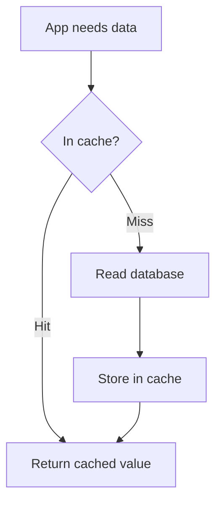

# Caching

A chaiwala keeps the most-asked orders ready instead of starting from scratch each time. A cache does the same for data: keep popular answers close and fast.

## What it is

A **cache** is a small, fast store that holds copies of data from a slower, bigger store. A request first checks the cache. A **hit** is served at once. A **miss** goes to the database. Caches exist at many levels: browser, CDN ([Chapter 1](../01-networking.md)), an application cache such as Redis or Memcached, and the database's own memory.

## How it works: common patterns

**Cache-aside (lazy loading).** The application manages the cache. AWS documentation calls this lazy loading.



*Figure: Cache-aside. Only data that is actually requested gets cached.*

```python
def get_user(uid):
    value = cache.get(f"user:{uid}")
    if value is None:
        value = db.fetch_user(uid)          # slow path
        cache.set(f"user:{uid}", value, ex=300)  # expire in 300 s
    return value
```

| Pattern | How it works | Good | Bad |
|---|---|---|---|
| Cache-aside | Read: check cache, else DB, then fill cache | Caches only what is used; cache failure is not fatal | Miss is slow; data can go stale |
| Write-through | Every write updates cache and DB | Cache is fresh | Slower writes; caches data nobody reads |
| Write-behind | Write to cache, DB is updated later | Fast writes | Data can be lost if the cache fails first |
| TTL (time to live) | Entries expire after a set time | Limits staleness | Does not guarantee freshness |

The first, second and fourth rows follow the AWS ElastiCache guide. Write-behind is a general pattern used by some systems.

## Invalidation: the hard part

When the database changes, the cached copy becomes wrong. Options: wait for TTL, update the cache on write, or delete the cached entry on write.

Facebook's memcache paper chose to **delete** cached data after a database write instead of updating it, because deletes are idempotent (repeating them is harmless).

Two classic bugs from that paper:

- **Stale set**: two concurrent updates get reordered, and an old value ends up in the cache.
- **Thundering herd**: a hot key keeps getting invalidated, so many readers hit the database together. This is also what happens when a popular key expires (a "cache stampede").

Facebook used **leases**: a token given to one client on a miss, so only that client refills the cache and others wait briefly. A lease is cancelled if the key is deleted, which blocks stale sets. In their data, peak database queries on a set of herd-prone keys dropped from 17K per second to 1.3K per second.

Simple defences you can use: add random jitter to TTLs so keys do not expire together, and let only one request rebuild a missing key.

## Trade-offs

- A cache adds a second copy of the truth. Staleness is the price of speed.
- Memory is limited, so a cache evicts items (often least recently used).
- Treat the cache as disposable. The database stays the source of truth.

## In the AI era

LLM calls are slow and costly, so caching helps a lot. Prompt, prefix and semantic caches are explained in [Chapter 6](../../module-3/06-llm-serving.md). The same invalidation rule applies: if a document changes, answers built from the old version may need to expire.

> [!TIP]
> **Key takeaways**
> - Cache-aside is the default pattern. Add TTLs, and jitter them.
> - Invalidation is the hard part. Deleting on write is simpler and safer than updating.
> - Guard hot keys against stampedes. Never treat the cache as the source of truth.
