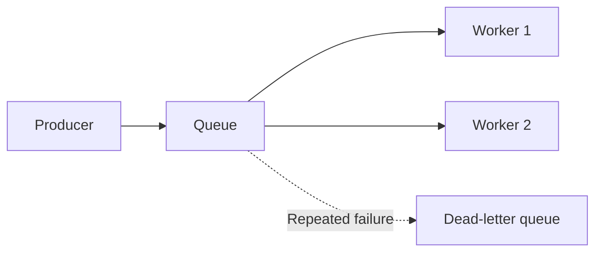
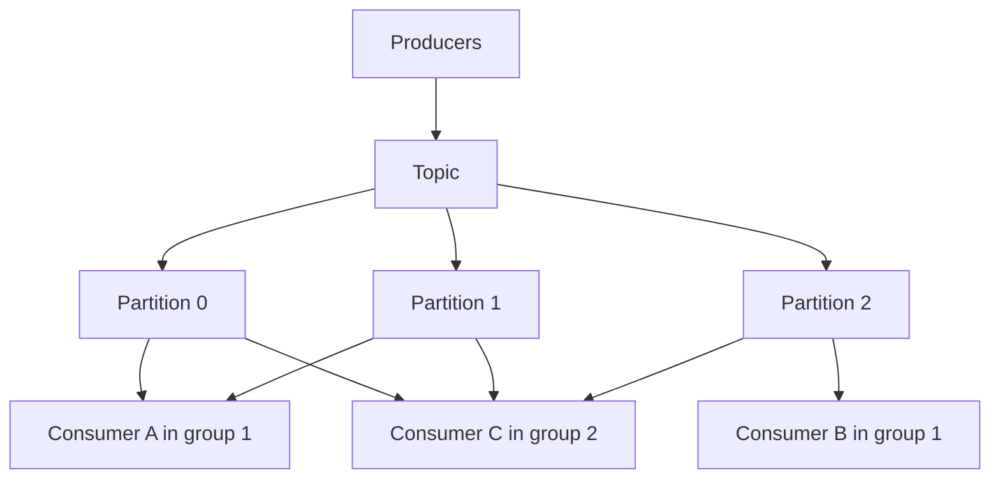

# Message Queues and Logs

In a busy kitchen, the order slip goes on a rail. The waiter does not wait for the dish. The cook picks slips when ready. A message queue works like that rail. A log is more like a ledger that keeps every slip for anyone to read again.

## What it is

A **message broker** sits between a producer (who sends) and a consumer (who processes). It decouples them: the producer does not wait, and a slow consumer does not block it. Two styles matter.

- **Queue**: each message is handed to a consumer, processed, then deleted. Amazon SQS is an example.
- **Log**: an append-only, ordered record of events. Consumers read at their own pace, and events stay until retention expires. Apache Kafka is the best-known example.

## How a queue works (SQS-style)

SQS standard queues give **at-least-once delivery**: a message may arrive more than once, and order is best-effort. When a consumer receives a message, it becomes invisible for a **visibility timeout** (default 30 seconds). If the consumer does not delete it in time, it appears again for another try. A **dead-letter queue (DLQ)** collects messages that keep failing.

*Figure: Workers share a queue. Each message is processed by one worker, then deleted.*

## How a log works (Kafka-style)

Kafka's introduction describes these parts:

- A **topic** is a named container for events. Events are **not deleted after consumption**.
- A topic is split into **partitions**, spread over brokers. Events with the same key go to the same partition.
- Kafka guarantees order **within a partition**, not across the whole topic.
- A **consumer group** shares the work. Each partition goes to exactly one consumer in the group.
- **Retention** is configurable. Replication copies each partition on several brokers, and a replication factor of 3 is common in production.

*Figure: Two consumer groups read the same log independently. Inside a group, each partition has one reader.*

Because the log is kept, a new service can replay history, and a bug fix can reprocess old events. Kafka 4.0 (March 2025) is the first major release that runs without ZooKeeper, using its own KRaft mode.

## Trade-offs

| Point | Queue | Log |
|---|---|---|
| Message after processing | Deleted | Kept until retention ends |
| Replay old data | No | Yes |
| Many independent readers | Awkward | Natural (consumer groups) |
| Ordering | Best-effort, or per group in FIFO queues | Per partition |
| Best for | Task distribution, background jobs | Event streams, pipelines, audit trail |

## Delivery guarantees

Committing a Kafka offset (your position in the log) only after processing gives at-least-once delivery. A crash before the commit means some records are reprocessed. Committing early risks losing records instead. So consumers should be **idempotent**: handling the same message twice must be harmless. [Chapter 3](../03-reliability.md) covers this.

## In the AI era

Queues absorb bursts of slow LLM jobs such as document summarising or batch embedding, so the API stays responsive. Logs carry user events to feature pipelines ([Chapter 5](../../module-2/05-feature-stores.md)) and document changes to RAG ingestion ([Chapter 7](../../module-3/07-rag-architectures.md)).

> [!TIP]
> **Key takeaways**
> - A queue hands out tasks and deletes them. A log keeps ordered history that many readers can replay.
> - Kafka orders events per partition. Use a key to keep related events together.
> - Assume duplicates. Make consumers idempotent.
