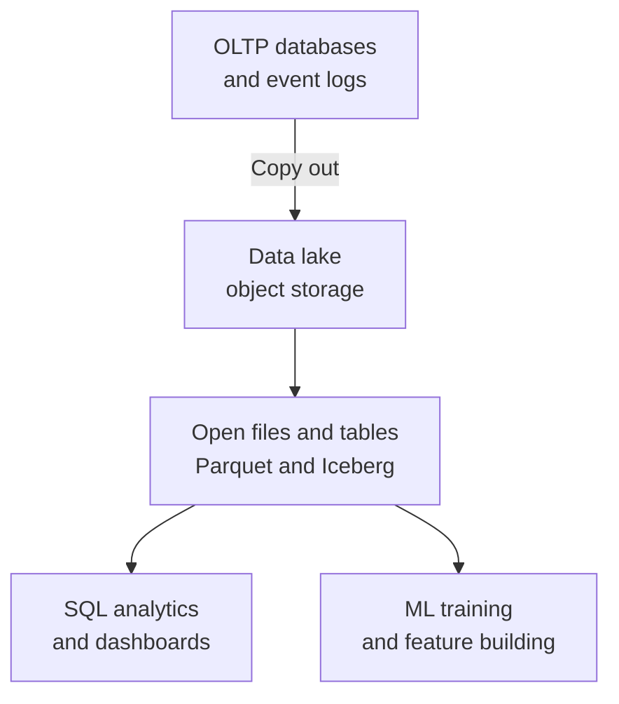

# Object Storage, OLAP and Data Lakes

Your phone photos, app logs and model checkpoints do not belong in a relational table. They are big blobs, and you want them cheap and safe. That is the job of object storage.

## What it is

**Object storage** keeps data as **objects** inside **buckets**. An object is the data plus metadata. Each object has a unique **key** (its name) in the bucket. You use it through an HTTP API, not through a file system. Amazon S3 is the best-known example.

What AWS documents about S3 (as of November 2026):

- S3 Standard and most other classes are designed for 99.999999999% (eleven nines) durability. Objects are stored across at least three Availability Zones.
- S3 gives strong read-after-write consistency for PUT and DELETE, including LIST after a write.
- Updates to one key are atomic. There is **no atomic update across keys**. Two simultaneous writes to one key follow "latest timestamp wins".
- Storage classes trade cost against access speed, from frequent access to archive.

So object storage is great for large files, backups and datasets. It is poor for small, frequent, in-place updates. For that, use a database.

## OLTP vs OLAP

Two very different workloads need two kinds of systems.

| Point | OLTP (transactions) | OLAP (analytics) |
|---|---|---|
| Purpose | Run the business: orders, payments | Understand the business: reports, trends |
| Workload | Many small reads and writes | Heavy queries over large history |
| Response time | Milliseconds | Seconds to minutes |
| Storage layout | Row-oriented | Column-oriented |

(Purpose, workload and response time follow the AWS description of OLAP and OLTP. The storage layout row is the common practice.)

A **column-oriented** format stores each column together. An analytics query that needs two columns out of fifty reads only those two. **Apache Parquet** is an open column-oriented file format used widely for this.

Running big reports on your live OLTP database slows your app. So teams copy data out to an analytics system.

## Warehouse, lake and lakehouse

The Lakehouse paper (CIDR 2021) tells the story in three steps.

1. **Data warehouse**: data is cleaned and shaped when written (schema-on-write) for reports. It struggles with unstructured data like text, audio and video.
2. **Data lake**: raw data goes into low-cost storage in open formats such as Parquet, and structure is applied when read (schema-on-read). Cheap and flexible, but data quality and governance are pushed downstream.
3. **Lakehouse**: the paper's proposal to unify both: open formats, warehouse-style management, and support for machine learning.

**Apache Iceberg** is an open table format that supports this on object storage. Its site lists SQL row-level updates, schema evolution, time travel to past snapshots and compaction. Engines such as Spark, Trino and Flink can work on the same tables. S3 now offers table buckets that store tables in Iceberg format.

*Figure: A typical flow. The lake is the shared, low-cost base for analytics and ML.*

## In the AI era

Object storage holds training data, model files, document corpora and logs. A lake feeds feature pipelines ([Chapter 5](../../module-2/05-feature-stores.md)) and evaluation datasets. S3 also now has vector buckets for storing and searching embeddings. Vector search design is covered in [Chapter 7](../../module-3/07-rag-architectures.md).

## Common mistakes

- Using object storage like a database, with many tiny updates.
- A lake with no ownership or catalogue, so nobody trusts the data.
- Analytics on the live OLTP database.

> [!TIP]
> **Key takeaways**
> - Object storage is cheap, durable and strongly consistent per key, but has no multi-key transactions.
> - OLTP serves the live app. OLAP answers questions over history, usually from column-oriented files.
> - A lakehouse puts table features such as snapshots on top of open files in object storage.
