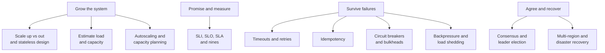

# Chapter 3: Scalability & Reliability

Think of IRCTC at 10 am on a Tatkal booking day. Lakhs of people hit the same site at the same minute. If the system only works when traffic is small, it is not a good system.

Scalability means your system keeps working well when load grows. Reliability means it keeps working when things break. In a distributed system, things always break: a disk fails, a network call hangs, a whole data centre goes dark.

This matters even more in the AI era. LLM calls are slow and costly. They fail in new ways (rate limits, overload, timeouts). An agent may call ten tools in one task, so one weak link can spoil the whole run. The ideas in this chapter are the base for everything that follows in the book.

*Figure: The map of this chapter. First grow, then promise and measure, then survive failures, then recover.*

## What you will learn

- **Scaling Up vs Scaling Out**: why most systems add more machines, and why stateless servers make that easy.
- **Back-of-the-Envelope Estimation**: turning "10 million users" into requests per second, servers and storage.
- **SLI, SLO, SLA and the Nines**: how to say "reliable" with numbers, and what an error budget is.
- **Timeouts, Retries, Backoff and Jitter**: how to retry without making an outage worse.
- **Idempotency**: how to make retries safe, so a payment is not taken twice.
- **Circuit Breakers and Bulkheads**: how to stop one slow dependency from sinking everything.
- **Backpressure and Load Shedding**: what to do when more work arrives than you can handle.
- **Consensus and Leader Election**: how servers agree on one truth, with the idea behind Raft.
- **Multi-Region Design and Disaster Recovery**: surviving the loss of a whole region.
- **Autoscaling and Capacity Planning**: adding and removing capacity at the right time.

Then a recap with practice questions and sources.
