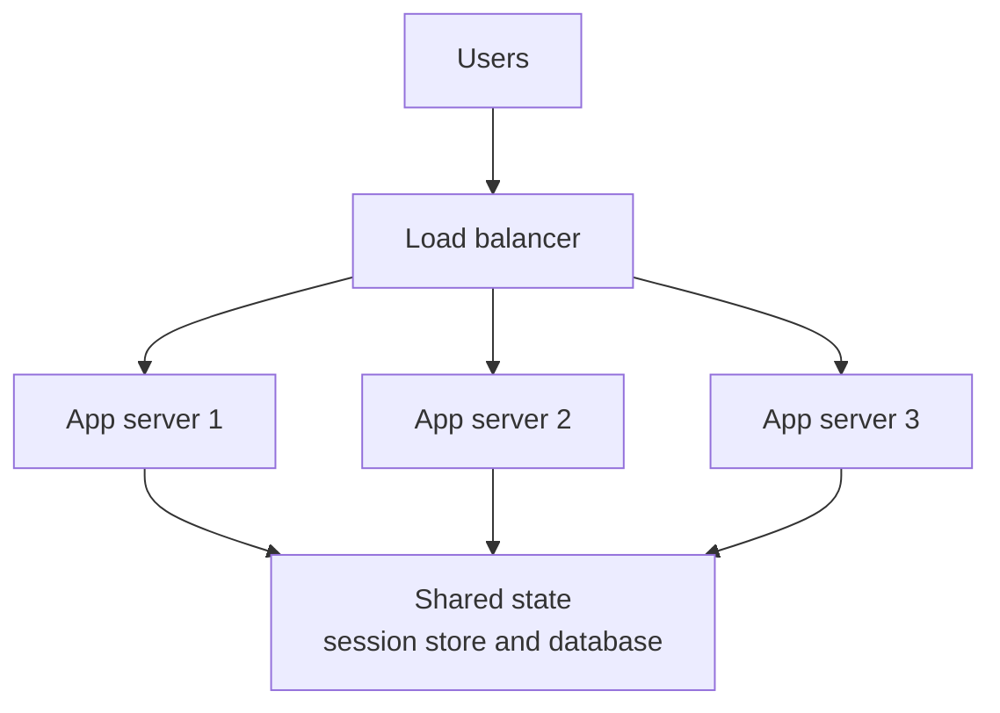

# Scaling Up vs Scaling Out

A small tea stall gets busy. You can buy a bigger stove, or you can open a second stall next door. Both help. They fail in different ways.

## What it is

- **Scaling up (vertical):** give one machine more CPU, memory or disk.
- **Scaling out (horizontal):** add more machines and share the work between them.

Scaling up is simple. Your code does not change. But one machine has a hard ceiling, and is a single point of failure: if it dies, everything stops.

Scaling out has no such ceiling and survives single failures. But you now run a distributed system, and the software must be designed for it. Some applications cannot scale out at all, and scale-out storage often gives only eventual consistency (Wikipedia, "Scalability"). We cover storage in [Chapter 2](../02-storage.md).

| | Scale up | Scale out |
|---|---|---|
| Effort | Low, change the machine | Higher, design for many machines |
| Limit | Biggest machine you can buy | Much higher |
| Failure | One machine is a single point of failure | One machine failing is normal |
| Good for | Small systems, databases at first | Web and API tiers, workers |

## How it works: stateless servers make scale-out easy

A server is **stateless** if it keeps nothing about a user between requests. Any server can then handle any request. The load balancer ([Chapter 1](../01-networking.md)) can send traffic anywhere, and you can add or remove servers freely.

The Twelve-Factor App method says the same: processes are stateless and share-nothing, and anything that must last belongs in a backing service like a database. It also says sticky sessions (a visitor's session kept in one process's memory, with the load balancer routing them back to it) "should never be used or relied upon". Put session data in a store such as Redis or Memcached instead.

*Figure: Servers hold no user state. All state lives in a shared store, so any server can serve any request.*

Local memory or disk is fine as a short-lived cache inside one request. Just never assume it will be there for the next one. A restart, deploy or move can wipe it at any time.

## Trade-offs

- **Scale up first when it is cheap and simple.** Many products run happily on a bigger database machine for a long time.
- **Scale out the stateless tiers early.** It is the easiest win. Keep the database as the hard part.
- **Stateless is not free.** Every request must fetch its state from a shared store. That adds a network hop and makes the store a critical dependency.
- **Scaling has diminishing returns.** Adding hardware does not give a proportional speed-up when part of the work cannot be split up (Amdahl's law).

## In the AI era

A chat app looks stateful, because the model "remembers" the conversation. In reality the model call is stateless: you send the full history each time. So keep conversation history, agent progress and tool results in a database or cache, not in server memory. Then any worker can pick up any conversation. Agent state is covered in [Chapter 8](../../module-4/08-agentic-architectures.md).

GPU servers for LLMs are different. They are heavy, hold large models in memory, and cannot be started in a second. [Chapter 6](../../module-3/06-llm-serving.md) covers this.

## Common mistakes

- Storing uploaded files or sessions on the app server's disk.
- Using sticky sessions to "fix" a state problem instead of moving the state.
- Scaling out the app tier while the single database stays the bottleneck.

> [!TIP]
> **Key takeaways**
> - Scale up is simple but limited; scale out is flexible but needs design.
> - Stateless servers hold no user state, so any server can serve any request.
> - Move state to a shared store, and remember that store now needs its own scaling and reliability.
