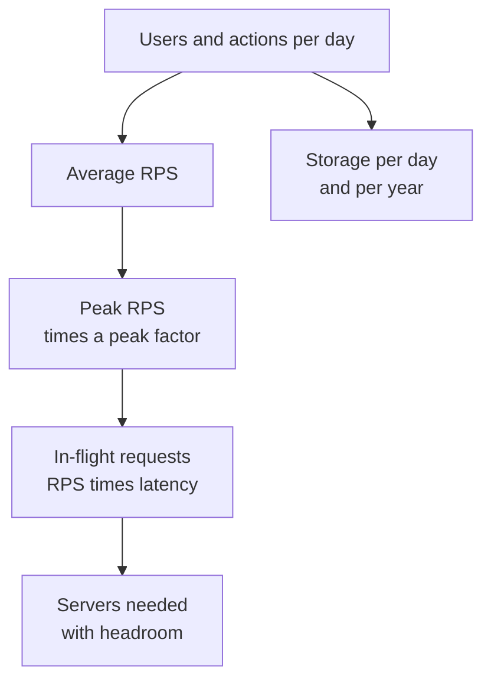

# Back-of-the-Envelope Estimation

Before booking a hall for a wedding, you ask "how many guests?" Then you work out chairs, food and parking. Estimation in system design is the same. You get a rough size first, then choose the design.

## What it is

A quick calculation with simple numbers, done in a minute or two, to find the order of magnitude: is it 100 requests per second, or 100,000? The goal is not the exact answer. The goal is to know if one machine is enough, if you need sharding, or if the cost will hurt.

> [!NOTE]
> All numbers in the worked examples below are **assumptions** made up to teach the method. They are not real traffic figures of any company.

## How it works

Follow the same steps each time:

1. Start from users: daily active users (DAU) and actions per user.
2. Convert to requests per second (RPS). One day is 86,400 seconds, so round to about 100,000 for quick maths.
3. Apply a peak factor, because traffic is not flat.
4. Estimate storage: records per day times size per record.
5. Estimate servers, using Little's law.

**Little's law** says: average number in the system = arrival rate x average time spent in the system (L = lambda x W). It holds whatever the arrival pattern is. Here it tells you how many requests are in flight at once.

*Figure: From user numbers to servers and storage.*

### Worked example (all values assumed)

Assume 10 million DAU, each making 20 requests a day.

| Step | Calculation | Result |
|---|---|---|
| Requests per day | 10M x 20 | 200M |
| Average RPS | 200M / 86,400 | about 2,300 |
| Peak RPS (assume 3x) | 2,300 x 3 | about 7,000 |
| In-flight requests (assume 200 ms average) | 7,000 x 0.2 s | about 1,400 |
| Servers (assume 100 concurrent each) | 1,400 / 100 | 14 |
| With 50% target utilisation | 14 x 2 | about 28 |

For storage, assume 1 million new records a day at 1 KB each. That is about 1 GB a day, or about 365 GB a year, before replication. If you keep 3 copies, multiply by 3.

## Numbers worth remembering

Approximate latencies (from the interactive "Latency Numbers Every Programmer Should Know" page, which shows formula-based estimates for 2020, not measurements):

| Operation | About |
|---|---|
| Main memory reference | 100 ns |
| SSD random read | 16 microseconds |
| Round trip inside one data centre | 500 microseconds |
| Disk seek | 3 ms |
| Packet round trip, California to Netherlands | 150 ms |

The lesson: memory is far faster than disk, and disk is far faster than a trip across the world. That is why caching and regions matter.

## In the AI era

Add one more row: tokens. Assume 5 million chats a day, each with 2,000 input tokens and 500 output tokens. That is 10 billion input tokens and 2.5 billion output tokens a day, or roughly 116,000 input and 29,000 output tokens per second on average. Now you can compare this with a provider's token-per-minute limits, or with your own GPU capacity ([Chapter 6](../../module-3/06-llm-serving.md)).

Also remember that an LLM call takes much longer than a database call. By Little's law, slow calls mean many more requests in flight at the same time.

## Common mistakes

- Using average load and forgetting the peak.
- Forgetting replication, indexes and backups in storage.
- Chasing exact numbers. Round aggressively and state your assumptions out loud. [Chapter 13](../../module-6/13-interview-framework.md) shows how to do this in an interview.

> [!TIP]
> **Key takeaways**
> - Estimate in order of magnitude: users to RPS to peak to servers and storage.
> - Little's law links request rate and latency to the number of requests in flight.
> - Always say your assumptions, and always include a peak factor and headroom.
