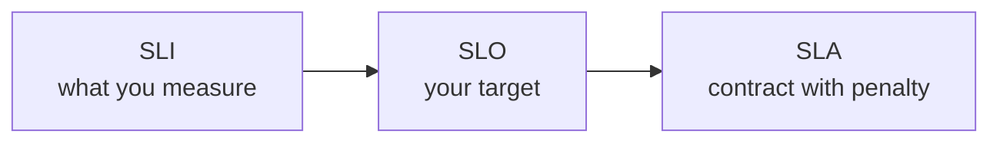

# SLI, SLO, SLA and the Nines

"Is our service reliable?" is a bad question. "Did 99.9% of requests succeed last month?" is a good one. Numbers turn opinions into decisions.

## What it is

Three terms, as defined in Google's SRE book:

- **SLI (Service Level Indicator):** a measurement of service quality. Examples: request latency, error rate, availability (the fraction of valid requests that succeed).
- **SLO (Service Level Objective):** a target for an SLI. Example: "99.9% of requests succeed" or "99% of requests finish in under 300 ms".
- **SLA (Service Level Agreement):** a contract with consequences if the SLOs are missed, usually money back. A simple test: "what happens if we miss it?" If nothing formal, it is an SLO.

*Figure: Measure it, set a target, then (maybe) promise it in a contract.*

Keep your internal SLO stricter than the SLA you sign, so you have room before you pay a penalty.

## How it works: the nines

Availability is the share of time (or requests) in which the service works. People say "three nines" for 99.9%. AWS lists the maximum downtime per year as:

| Availability | Downtime per year | Downtime per 30-day month (calculated) |
|---|---|---|
| 99% | 3 days 15 hours | about 7.2 hours |
| 99.9% | 8 hours 45 minutes | about 43 minutes |
| 99.99% | 52 minutes | about 4.3 minutes |
| 99.999% | 5 minutes | about 26 seconds |

Each extra nine cuts allowed downtime by ten times, but costs much more. AWS notes that higher availability needs more testing, more automation, and slower changes.

### Combining components

- **In a chain (hard dependencies):** multiply. Three components at 99.99% each give about 99.97%. Your service can never be more available than the things it cannot work without.
- **In parallel (independent redundant copies):** take 100% minus the product of failure rates. Two independent components at 99.9% give 99.9999%. This is why we run copies in different availability zones.

If a vendor does not publish a number, estimate: availability = MTBF / (MTBF + MTTR), where MTBF is mean time between failures and MTTR is mean time to recover. Example from AWS: 150 days and 1 hour gives about 99.97%.

## Error budgets

If the SLO is 99.9%, you are *allowed* 0.1% failures. That is your **error budget**. Google's SRE book calls it "an SLO for meeting other SLOs". While budget remains, ship features. When it is nearly gone, slow down and fix reliability. It gives teams a fair, measurable way to balance "move fast" and "stay stable".

**Burn rate** tells how fast you spend the budget. A burn rate of 1 uses exactly the whole budget by the end of the window. The SRE Workbook suggests paging for a 99.9% SLO when the burn rate is 14.4 over 1 hour (that spends 2% of a 30-day budget), confirmed by a short 5-minute window so the alert clears quickly.

## In the AI era

Classic SLIs still apply to LLM features: availability, latency and error rate. Add time to first token and inter-token latency ([Chapter 6](../../module-3/06-llm-serving.md)). Quality is harder: an answer can return in time with HTTP 200 and still be wrong. So teams add quality measures from evaluations ([Chapter 12](../../module-5/12-evaluation-safety.md)). Also, your own SLO depends on the model provider's availability, so the chain maths above applies to you. Monitoring is covered in [Chapter 11](../../module-5/11-observability.md).

## Common mistakes

- Promising 100%. It is not possible and not useful.
- Measuring server uptime instead of what users experience.
- Setting an SLA before you have measured an SLI for months.

> [!TIP]
> **Key takeaways**
> - SLI is the measurement, SLO is the target, SLA is the contract with penalties.
> - Each extra nine is ten times less downtime and much more cost; chained dependencies multiply, redundancy helps.
> - An error budget turns reliability into a shared, measurable trade-off with feature speed.
