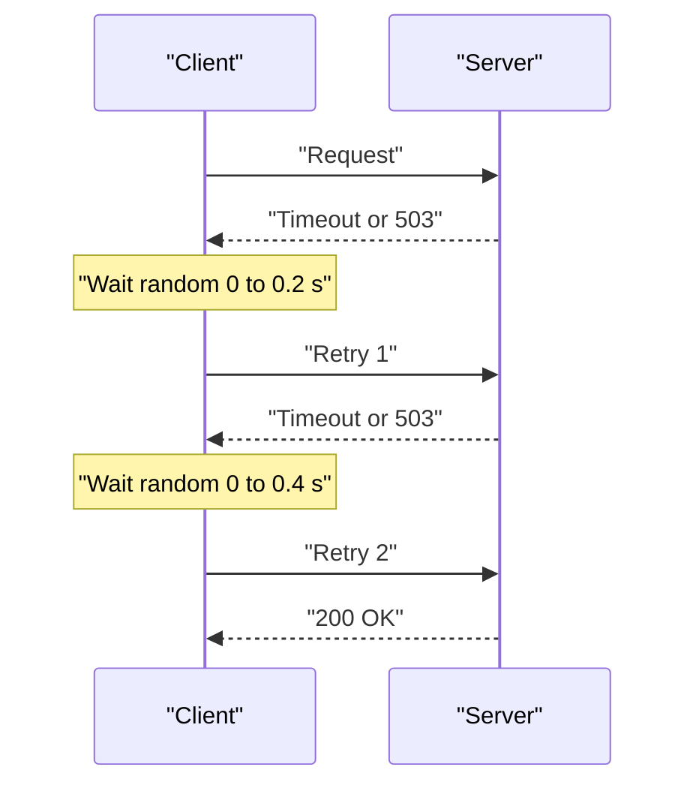

# Timeouts, Retries, Backoff and Jitter

You call a friend. No answer. You wait, then call again. Now imagine 10,000 people calling the same friend every second. That friend will never pick up. This is how bad retries turn a small problem into an outage.

## What it is

- **Timeout:** the longest you will wait for a reply.
- **Retry:** sending the same request again after a failure.
- **Backoff:** waiting longer after each failed attempt (usually doubling the wait).
- **Jitter:** adding randomness to the wait so clients do not all retry at the same moment.

## How it works

**Always set a timeout** on any remote call. Without one, a hung dependency can hold your threads and connections forever. AWS also notes the trade-off: too high and the timeout is useless, too low and you create extra retries. A practical method from AWS: pick an acceptable false-timeout rate (say 0.1%) and use the matching latency percentile (p99.9) of the dependency.

**Retries help with short, transient failures.** AWS calls retries "selfish": they spend more server capacity to raise your own chance of success. That is fine when failures are rare, and harmful when the server is overloaded.

**Backoff and jitter.** A common formula is called *full jitter*: wait a random time between 0 and min(cap, base x 2^attempt). In AWS's simulation of many clients competing, full jitter did the least total work among the options tested, and no-jitter backoff did the worst. Most AWS SDKs now use exponential backoff with jitter.

```python
import random, time

def call_with_retry(fn, max_attempts=4, base=0.2, cap=5.0):
    for attempt in range(max_attempts):
        try:
            return fn()
        except TransientError:           # your own error class
            if attempt == max_attempts - 1:
                raise
            wait = random.uniform(0, min(cap, base * 2 ** attempt))
            time.sleep(wait)
```



*Figure: Each wait grows, and each wait is random.*

## Retry rules that save you

| Rule | Why |
|---|---|
| Limit attempts | Never retry forever. |
| Retry at one layer only | With 5 layers and 3 retries each, the database can see 243 times the load (AWS example). |
| Do not retry client errors (4xx) | The same bad request will fail again. |
| Use a retry budget | A token bucket lets a client retry freely while tokens last, then slowly. Google SRE suggests a server-wide retry budget too. |
| Retry only side-effect-safe calls | Otherwise you need [idempotency](./05-idempotency.md). |
| Honour `Retry-After` | The server knows when it will be ready. |

## In the AI era

LLM APIs fail with rate limits (HTTP 429) and overload. Anthropic's API docs say that when a 429 includes a `retry-after` header you should wait that many seconds, and their official SDK retries transient failures twice by default with exponential backoff. Not every 429 is retryable: a monthly spend-cap 429 has no `retry-after` and keeps failing until access resumes. So read the error type before retrying.

Long generations need patient timeouts, and the docs advise streaming or batch for long requests. Agent loops add a danger: if each step retries three times and each tool call may be retried by the agent too, retries multiply. Decide which layer owns retries.

## Common mistakes

- No timeout, or the same huge timeout everywhere.
- Retrying instantly in a tight loop.
- Capped backoff without jitter: all clients still retry together at the cap.
- Retrying at the client, the gateway and the service together.

> [!TIP]
> **Key takeaways**
> - Set a timeout on every remote call, based on real latency percentiles.
> - Retry with exponential backoff and jitter, a small attempt limit and a retry budget.
> - Retry at one layer only, and only when the call is safe to repeat.
