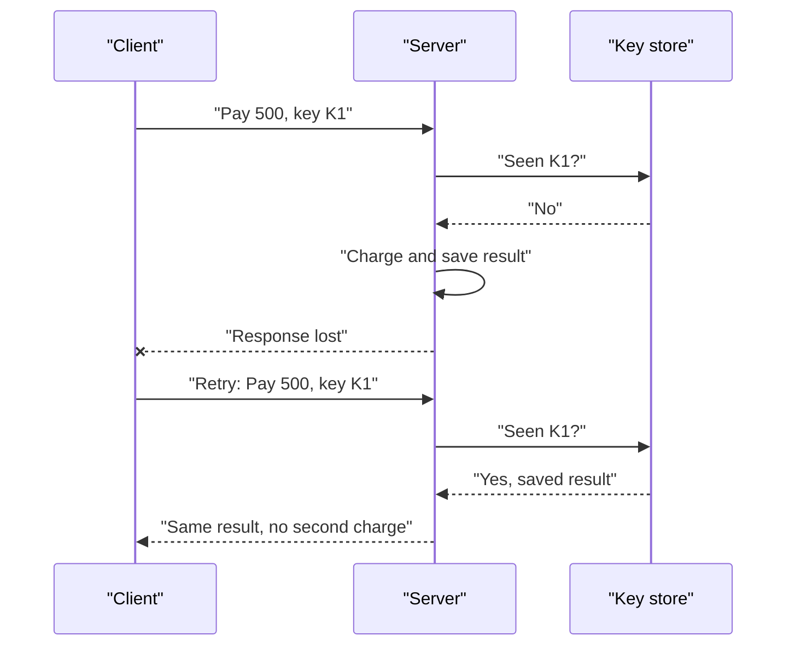

# Idempotency

You press "Pay" on a UPI app. The screen hangs. Did the money go? You are afraid to press again. The app should make pressing again safe. That is idempotency.

## What it is

An operation is **idempotent** if doing it once or many times gives the same final result. Setting a value to 5 is idempotent. Adding 5 to a balance is not.

Reads are naturally idempotent. HTTP `GET` and `DELETE` are idempotent by definition (Stripe's docs say so). Creating things, charging cards and sending messages are not, unless you design them to be. AWS puts it simply: APIs with side effects are not safe to retry unless they provide idempotency.

## How it works: the idempotency key

The client creates a unique **idempotency key** for each logical action and sends it with every attempt of that action. The server remembers the result for that key.



*Figure: The retry gets the saved result. The charge happens only once.*

Stripe is a good real example. Its API accepts an `Idempotency-Key` header:

```bash
curl https://api.stripe.com/v1/customers \
  -u sk_test_...: \
  -H "Idempotency-Key: KG5LxwFBepaKHyUD" \
  -d description="My First Test Customer"
```

From Stripe's documentation (API v1):

- It saves the status code and body of the first request for a key, even if it was a `500` error, and returns that on retries.
- Keys are up to 255 characters; random V4 UUIDs are suggested.
- Keys can be removed after they are at least 24 hours old.
- If a retry uses the same key with different parameters, it returns an error. This catches misuse.
- Results are saved only once execution begins. A request that failed validation can simply be retried.

## Server-side rules

1. Store the key in the **same transaction** as the business change, or use a unique constraint on the key. Otherwise two parallel retries can both pass the "seen?" check.
2. Store the response too, so you can replay it.
3. Decide how long to keep keys, longer than your clients' maximum retry window.
4. Handle "in progress": if a second request arrives while the first still runs, make it wait or return a clear conflict.

## Other ways to get idempotency

| Method | Example |
|---|---|
| Natural idempotency | "Set status to shipped", not "add one to count" |
| Idempotency key | Payments, order creation |
| Unique business id | Insert with a unique order number, ignore duplicates |
| Conditional update | "Update only if version is 7" |

Message queues often deliver a message at least once, so consumers also need to handle duplicates. See [Chapter 2](../02-storage.md).

## In the AI era

Agents call tools, and agents retry, replan and loop. If a tool sends an email, books a ticket or issues a refund, a repeated call has real cost. So give side-effect tools an idempotency key (for example, derived from the task id and step number), and return the old result when the same key appears again. Tool design for agents is discussed in [Chapter 8](../../module-4/08-agentic-architectures.md) and [Chapter 9](../../module-4/09-mcp.md).

## Common mistakes

- Generating a new key on every retry. Then the key protects nothing.
- Checking the key and doing the work in separate, non-atomic steps.
- Using personal data (like an email address) as a key.

> [!TIP]
> **Key takeaways**
> - Idempotent means repeating the action gives the same result as doing it once.
> - Use a client-made key and let the server save and replay the first result.
> - Key check and business change must be atomic; agents' side-effect tools need keys too.
