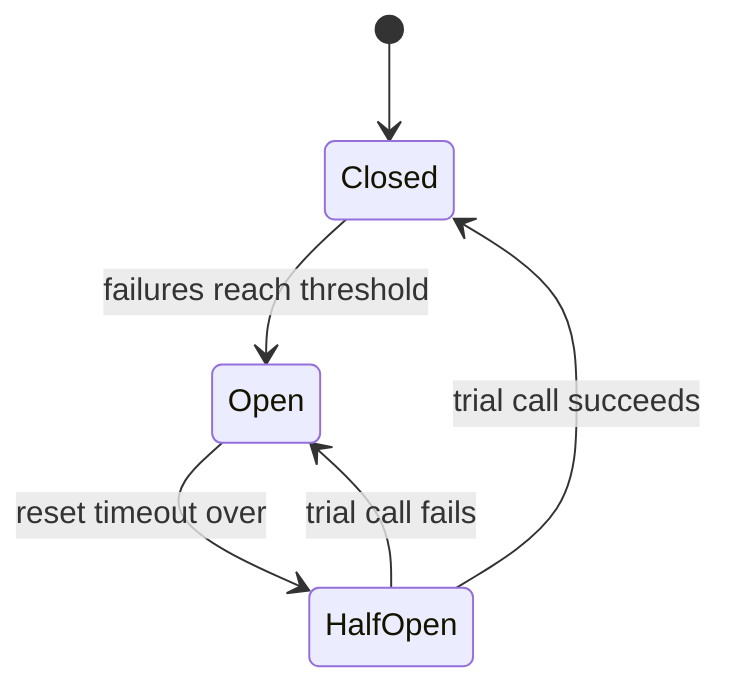
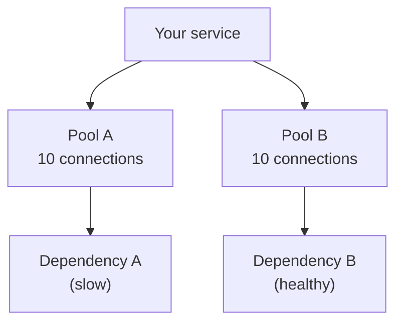

# Circuit Breakers and Bulkheads

At home, if a wire shorts, the MCB trips and cuts power to that circuit. The whole house does not burn. A ship has sealed compartments, so one leak does not sink it. Software can use both ideas.

## What it is

- **Circuit breaker:** a wrapper around a remote call. When the call keeps failing, the breaker "opens" and stops making the call for a while. It fails fast instead of waiting.
- **Bulkhead:** splitting resources into separate pools, so trouble in one pool cannot use up everything. The name comes from the sectioned partitions of a ship's hull.

Both stop a **cascading failure**: one slow dependency makes its callers slow, which makes their callers slow, until everything is down.

## How it works: the circuit breaker

Martin Fowler describes three states:

- **Closed:** calls pass through. Failures are counted. A success resets the count.
- **Open:** after the failure count reaches a threshold, calls return an error immediately, without trying. This saves waiting time and gives the struggling service a rest.
- **Half-open:** after a reset timeout, the breaker lets one trial call through. If it succeeds, the breaker closes. If it fails, it opens again and the timer restarts.

*Figure: Circuit breaker states.*

More advanced breakers trip on a failure rate (for example 50% of calls) instead of a raw count. Log every state change and alert on it: an open breaker is an early warning. Also decide what the caller does while the breaker is open: show cached or slightly old data, queue the work for later, or show a clear error.

AWS adds a caution: circuit breakers introduce modal behaviour (the system acts differently in each state) that can be hard to test. Test the open state on purpose.

## How it works: the bulkhead

Microsoft's Azure Architecture Center describes two common forms:

- **Consumer side:** give each dependency its own connection pool or thread pool. If Service A hangs, only A's pool fills up. Calls to Service B still work.
- **Service side:** run separate instances for different consumers. A heavy client cannot starve the others.

*Figure: A slow Dependency A can fill only Pool A. Dependency B keeps working.*

## Trade-offs

| Pattern | Gain | Cost |
|---|---|---|
| Circuit breaker | Fast failure, protects the weak service, quicker recovery | Needs tuning (threshold, reset time); extra states to test |
| Bulkhead | Contains damage, can give priority users their own pool | Less efficient use of resources; more to configure |
| Timeout only | Simple | Threads still wait up to the timeout on every call |

Azure notes bulkheads may not suit you if the lower resource efficiency is not acceptable. It also advises using built-in platform controls (rate limits, container resource limits) instead of rebuilding them in code. Libraries such as resilience4j and Polly provide these patterns.

## In the AI era

Azure's guidance points out that AI and inference workloads often need strict bulkheads because of deployment-level quotas and concurrency limits. In practice: do not let a batch job that summarises 100,000 documents use the same quota as your live chat. Give them separate pools, keys or deployments. A circuit breaker is also useful in front of an LLM provider: when it is failing, switch quickly to a fallback model or a friendly message instead of making every user wait for a timeout. Gateways that do this are covered in [Chapter 6](../../module-3/06-llm-serving.md).

## Common mistakes

- Breaker threshold too low, so normal blips trip it.
- No fallback plan for when the breaker is open.
- One shared thread pool for every dependency.

> [!TIP]
> **Key takeaways**
> - A circuit breaker (closed, open, half-open) stops calling a failing dependency and fails fast.
> - A bulkhead gives each dependency or consumer its own resource pool, so damage stays local.
> - Plan the fallback, and test the open state, not just the happy path.
