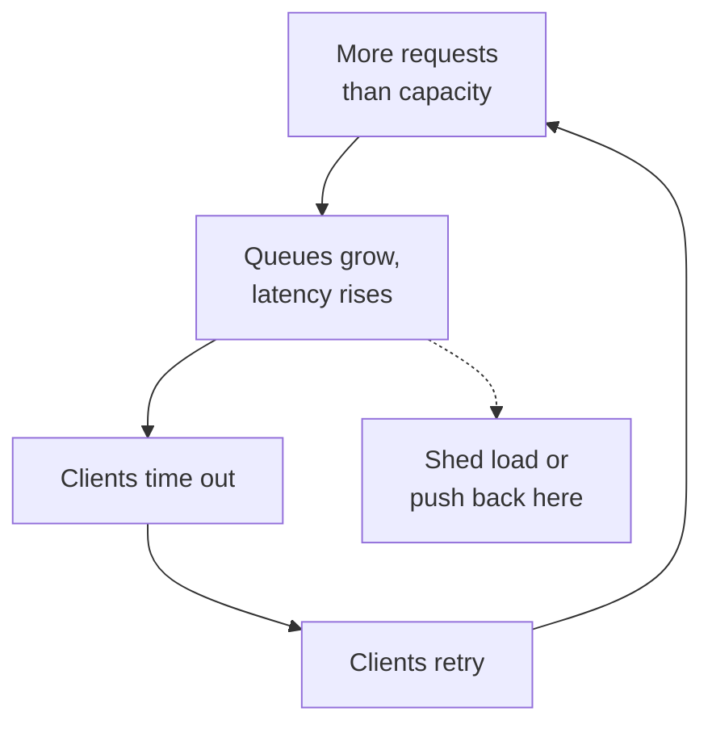

# Backpressure and Load Shedding

A railway platform has limited space. When too many people crowd in, the staff close the gate. People outside wait or go away. Without the gate, the platform becomes unsafe for everyone. Servers need such a gate too.

## What it is

- **Backpressure:** the receiver signals the sender to slow down, so work does not pile up without limit.
- **Load shedding:** when the server is near overload, it rejects some requests early, so that it can finish the others on time.

Both rest on one fact from Amazon's engineers: when a system gets more work than its resources support, it becomes slow. If it becomes slower than the client's timeout, requests fail, and a latency problem becomes an availability problem.

## How it works

**Goodput versus throughput.** Throughput is all requests per second sent to the server. Goodput is the part handled without errors, and fast enough to be useful. Under overload, throughput keeps rising while goodput can fall. Load shedding aims to keep goodput flat near full utilisation.

**The overload spiral.** Overload creates its own feedback loop: timeouts cause retries, retries add load, and the overload becomes steady state. Google's SRE book calls this a cascading failure and lists server overload as its most common cause.

*Figure: The loop that turns a spike into an outage, and where to break it.*

**Tools to break the loop:**

1. **Bounded queues.** Queues add memory use and latency. Google's SRE book warns that a queue ten times the thread count can turn a 100 ms request into about 1.1 seconds when full. Amazon bounds queues and discards requests that sat too long, and prefers fast failure to surge queues.
2. **Reject early and cheaply.** For example, return HTTP 503 when too many requests are in flight (SRE book).
3. **Tell clients to slow down.** Return a clear overload code (such as 429 with `Retry-After`) so well-behaved clients back off. The SRE book says to use a distinct overload status.
4. **Prioritise.** Serve critical requests, such as load balancer health checks, first. Shed background or non-critical traffic first.
5. **LIFO or CoDel queues.** Under overload, serving the newest requests first can help, because the oldest ones are probably abandoned by the caller already.
6. **Graceful degradation.** Do less work per request, like using a cache subset or a cheaper ranking method. The SRE book warns that this mode runs rarely, so exercise it regularly and keep a quick off switch.

## Trade-offs and cautions

- **False rejections hurt.** Amazon aims for zero false positives: do not reject requests when capacity exists. Load test far beyond the breaking point to see where goodput plateaus.
- **Shedding can hide the need to scale.** AWS notes that shedding keeps CPU low, which can stop CPU-based autoscaling from triggering. Scale on signals that include shed requests. See [Autoscaling](./10-autoscaling-capacity.md).
- **Client side matters too.** Pair this with [retry budgets and backoff](./04-timeouts-retries.md). The gate only works if people outside do not rush it again at once.

## In the AI era

LLM servers have a hard limit: GPU memory and tokens per second. Queueing more requests than the GPU can hold just makes every user wait longer. A gateway that bounds the queue, returns 429 or 503 quickly, and prioritises paying or interactive users is much better than silent waiting. Providers do this to you as well: Anthropic's API returns 429 on rate limits and also warns that a sharp rise in usage can trigger "acceleration limits", so ramp traffic up gradually. Batch work belongs on a lower-priority path. See [Chapter 6](../../module-3/06-llm-serving.md).

> [!TIP]
> **Key takeaways**
> - Overload makes systems slow, then failing; retries make it worse.
> - Bound your queues, reject early and cheaply, and tell clients to back off.
> - Protect critical traffic first, and make sure shedding does not blind your autoscaler.
