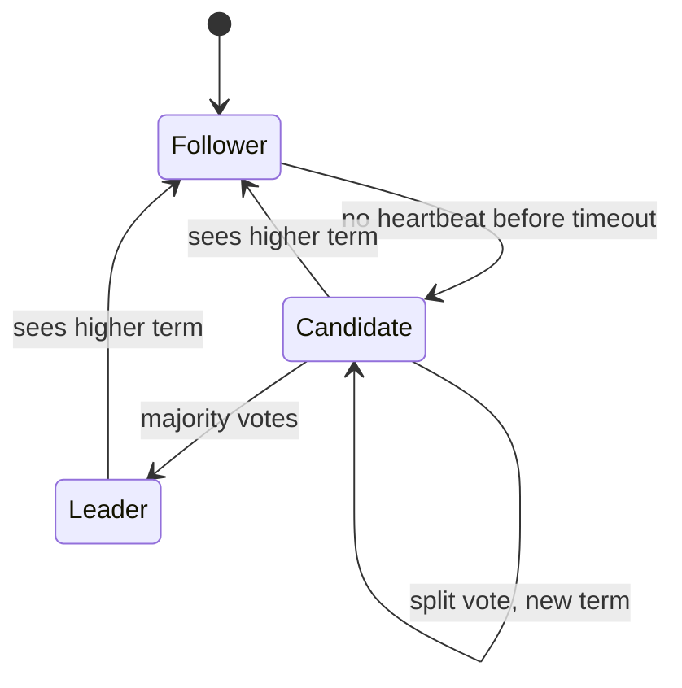

# Consensus and Leader Election

Five friends plan a trip. They must agree on one date. If two of them each announce a different date and both think they are in charge, the trip is a mess. Servers face the same problem, but the stakes are money and data.

## What it is

**Consensus** means several servers agree on a value, and once decided, the decision is final. It is needed when you want one copy of the truth that survives failures: who is the leader, what is the order of writes, which config is current.

A **leader** is one server chosen to take decisions (for example, to accept all writes). **Leader election** is how the group picks a new leader when the old one fails. The danger is **split brain**: two servers both believing they are the leader and accepting conflicting writes.

**Raft** is a consensus algorithm designed to be easy to understand. Its authors say it matches Paxos in fault tolerance and performance, but is split into more independent parts.

## How it works: the Raft idea

Every server is a **follower**, a **candidate** or the **leader**. Time is cut into **terms**, and each term starts with an election.

*Figure: Raft server roles.*

1. The leader sends regular **heartbeats** to the followers.
2. Each follower has an election timeout (typically 150 to 300 ms, per the Wikipedia summary of Raft) that resets on each heartbeat.
3. If a follower hears nothing before its timeout, it becomes a candidate. It adds one to the term, votes for itself and asks others for votes.
4. Each server votes once per term. A candidate with a **majority** of votes becomes leader.
5. If nobody wins (a split vote), a new term starts. Random timeouts make this rare, because one server usually times out first and wins before the others start.
6. A candidate or leader that sees a higher term steps down to follower. So an old leader cannot keep ruling after a new one is elected.

**Log replication.** The leader adds each client command to its log and sends it to the followers. When a majority has stored the entry, it is committed. All servers then apply the same commands in the same order, and reach the same state.

## Why a majority?

Two majorities of the same group always overlap in at least one server. So two different leaders cannot both be elected in one term. It also sets how many failures you can survive. For N servers, the majority is N/2 rounded down, plus 1.

| Servers | Majority needed | Failures tolerated |
|---|---|---|
| 3 | 2 | 1 |
| 4 | 3 | 1 |
| 5 | 3 | 2 |
| 7 | 4 | 3 |

This is why clusters have an odd number of servers: 4 servers tolerate no more failures than 3. The Raft site gives the same example: a 5-server cluster keeps running with 2 failed. If more fail, it stops making progress but does not give wrong answers. That is the safe choice. You will see this idea again with CAP in [Chapter 2](../02-storage.md).

## Where you meet it

You rarely write Raft yourself. You use systems built on it. According to Wikipedia (checked November 2026), these include etcd, CockroachDB, TiDB, YugabyteDB, RabbitMQ quorum queues, Redpanda, NATS JetStream and Apache Kafka's KRaft mode for metadata.

## In the AI era

Coordination problems appear in AI platforms too: which worker owns this training job, which replica holds the latest model version, which agent run is the single active one. Use a proven coordination store or database for these. Do not invent your own locking with timestamps; clocks drift, and that leads to split brain.

## Common mistakes

- Running consensus across too many servers. Every write needs a majority to confirm it, so a bigger cluster adds coordination cost.
- Two-server "clusters". If one fails, no majority exists.
- Using the consensus store for bulk data. Keep it for small, critical metadata.

> [!TIP]
> **Key takeaways**
> - Consensus lets servers agree on one value or one leader and survive failures.
> - Raft: followers, candidates, a leader, terms, heartbeats and majority votes.
> - A majority means odd cluster sizes; 5 servers tolerate 2 failures; the system stops rather than lies.
