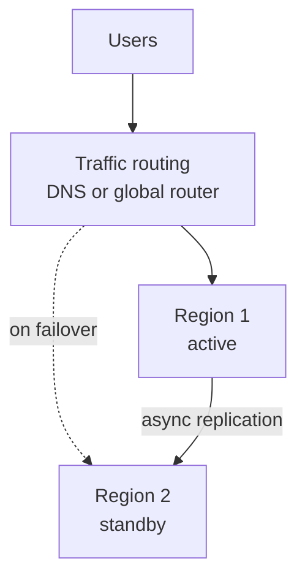

# Multi-Region Design and Disaster Recovery

A Mumbai data centre loses power for many hours, or a bad deployment corrupts your data. Can your service survive? A **region** is a separate geographic location with its own data centres. Multi-region design is about not keeping all your eggs in one basket.

## What it is

**Disaster recovery (DR)** is the plan and setup to get back to work after a major failure. Two numbers define it:

- **RTO (Recovery Time Objective):** how long you can be down. "Back within 1 hour."
- **RPO (Recovery Point Objective):** how much recent data you can lose, measured in time. "Lose at most 5 minutes of writes."

Smaller RTO and RPO mean more cost and more complexity. Choose them from business need, not from habit. A disaster can be a lost data centre, a lost region, or a human mistake that deletes or corrupts data.

## How it works: four strategies

AWS's disaster recovery whitepaper groups the options into four, from cheap and slow to costly and fast:

*Figure: Cost and complexity rise left to right. Recovery time falls.*

| Strategy | What runs in the second region | Recovery |
|---|---|---|
| Backup and restore | Only backups (copied across regions) | Slowest. You rebuild infrastructure and restore data. Use infrastructure as code. |
| Pilot light | Data replicated and live. Core infrastructure ready, app servers switched off | Faster. Switch on and scale out |
| Warm standby | A scaled-down but fully working copy | Faster still. Handles traffic at reduced capacity, then scale up |
| Multi-site active/active | Full workload serving traffic in several regions | Near zero for most disasters. Most complex and costly |

AWS adds a useful note: a pilot light cannot process requests until you take action. A warm standby can handle traffic at once, at lower capacity.

## Data is the hard part

In active/active, where do writes go? AWS lists three styles:

- **Write global:** all writes go to one region. If it fails, another is promoted. Simple, but far users see higher write latency.
- **Write local:** write to the nearest region. Needs conflict handling. DynamoDB global tables use "last writer wins".
- **Write partitioned:** each user or key has a home region, which avoids conflicts.

Replication between regions is usually asynchronous, so a failover can lose the last few moments of data. Replication also copies mistakes: if bad data or a malicious delete is replicated, your DR copy is bad too. So keep point-in-time backups and versioning as well. See replication and sharding in [Chapter 2](../02-storage.md).

## Failover: practical lessons from AWS

- **Prefer data plane over control plane for failover.** The data plane serves live traffic; the control plane configures things. AWS says data planes usually have higher availability goals, so depend on them during a disaster.
- **Be careful with automatic failover.** A false alarm also costs you downtime and some data. AWS notes that manual failover is often used, with the steps fully automated so that starting it is like pushing a button.
- **Check quotas in the DR region.** Service quotas must allow you to scale to full production capacity.
- **Test it regularly.** An untested DR plan is a hope, not a plan.
- **Do not forget human disasters.** Replication cannot fix deleted or corrupted data. Backups can.

*Figure: Active/passive. Traffic moves to Region 2 when Region 1 fails.*

## In the AI era

Model providers and GPU capacity can fail or run out in a region. Keep a fallback: a second provider or region, or a smaller model, with the same prompt and tool formats tested. Remember that GPU quotas in the standby region must be available before the disaster, not during it. Azure's guidance also stresses isolating model deployments per workload. Also back up what is hard to rebuild: vector indexes' source data, prompts, evaluation sets and agent state. Vector databases are covered in [Chapter 7](../../module-3/07-rag-architectures.md).

> [!TIP]
> **Key takeaways**
> - RTO is how long you can be down; RPO is how much data you can lose.
> - Four strategies: backup and restore, pilot light, warm standby, active/active. More money buys less downtime.
> - Replication is not backup; test failover, and check quotas in the standby region.
