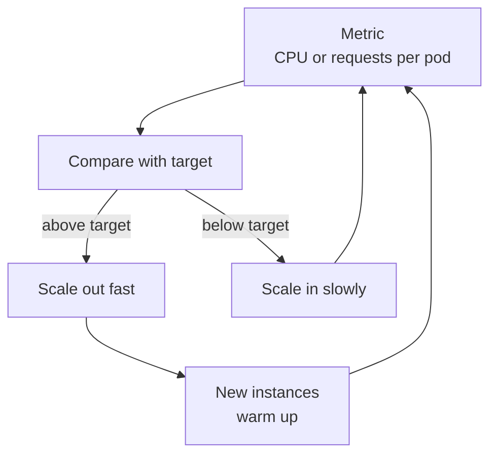

# Autoscaling and Capacity Planning

A restaurant adds tables on a festival day and removes them next week. A smart owner also books the extra chefs before the festival, not during the rush. Autoscaling is the quick reaction. Capacity planning is the advance thinking. You need both.

## What it is

- **Autoscaling:** automatically adding or removing instances (or pods) as load changes.
- **Capacity planning:** forecasting future demand and making sure enough capacity and redundancy exist to meet it at the needed availability (Google SRE book).

## How it works: autoscaling

Most autoscalers work like a thermostat: you set a target for a metric, and the system moves capacity to keep the metric near it.

**Kubernetes HPA (Horizontal Pod Autoscaler)** uses this formula from the Kubernetes docs:

```text
desiredReplicas = ceil( currentReplicas x currentMetricValue / desiredMetricValue )
```

Example: 4 pods at 90% CPU, target 60%. The result is ceil(4 x 90 / 60) = 6 pods.

Some defaults from the docs: the control loop runs every 15 seconds; scaling is skipped when the ratio is within a 10% tolerance; scale-down waits 300 seconds (a stabilisation window that uses the highest recent recommendation); scale-up has no window by default. These stop **flapping** (replica count going up and down quickly).

**AWS EC2 Auto Scaling target tracking** works the same way. Its example keeps average CPU near 50%. It scales out when CPU is above target and scales in more gradually, to prioritise availability. It also has an **instance warmup** time: a new instance is not counted in the metrics until warmup ends, so the group does not over-react.



*Figure: The autoscaling feedback loop.*

### Choosing the metric

The metric must rise and fall in proportion to the number of instances. AWS says request counts at the load balancer and latency do not work well for target tracking. A queue length can work if you convert it to "messages per instance". Scale on what is the real bottleneck: CPU, requests per pod, or queue depth per worker.

## The limits of autoscaling

- **It is slow.** Metrics lag, then instances start and warm up. A sudden spike hits before new capacity is ready. Keep headroom, for example a 50% CPU target.
- **It cannot beat other limits.** More app servers do nothing if the database is the bottleneck, or if account quotas block new instances.
- **Overload protection can hide the need.** AWS notes that load shedding can keep CPU low and stop CPU-based scaling from triggering.

## Capacity planning

The SRE book says three steps are mandatory:

1. An accurate **organic forecast** (natural growth) that looks further ahead than the time needed to get capacity.
2. Add **inorganic demand**: launches, marketing campaigns, big events.
3. **Regular load testing**, to link raw capacity (servers, disks) to the real capacity of the service.

Compare with [estimation](./02-estimation.md): estimation gives the first rough number, load tests give the real one, and the forecast tells you when you need it.

## In the AI era

GPU capacity is scarce, costly and slow to start, so reactive autoscaling alone is risky. Plan ahead, scale on queue depth or tokens in flight rather than CPU, and keep warm capacity for interactive traffic. Details are in [Chapter 6](../../module-3/06-llm-serving.md). On the client side, providers can also limit you: Anthropic's docs warn that a sharp increase in your usage can cause 429 errors from acceleration limits, so ramp traffic up gradually.

## Common mistakes

- Scaling on a metric that does not move with instance count.
- Scale-down too fast, causing flapping.
- A forecast with no load test behind it.

> [!TIP]
> **Key takeaways**
> - Autoscaling is a feedback loop: scale out quickly, scale in slowly, and allow warm-up time.
> - It reacts after the fact, so keep headroom and also plan capacity ahead with forecasts and load tests.
> - Pick a metric that tracks real load per instance, and check that other limits (database, quotas) do not block you.
