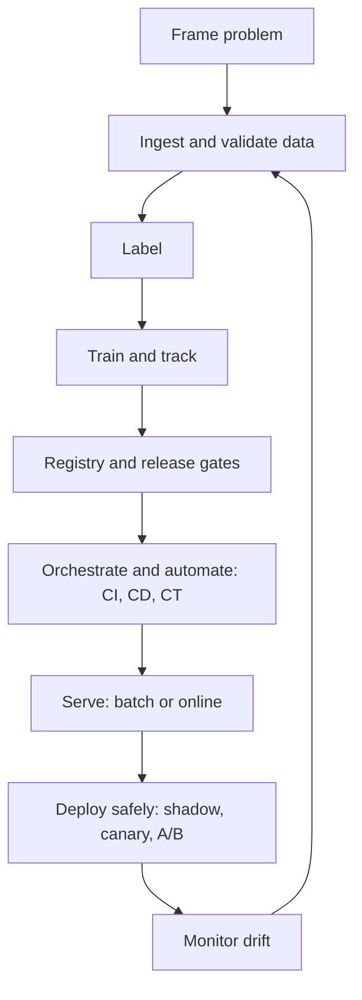

# Chapter 4: End-to-End ML Pipeline Architecture

Training a model in a notebook takes an afternoon. Keeping that model correct, fresh and safe for two years takes a system. Google's well-known paper on ML technical debt makes the point with one picture: the ML code is a small box in the middle of a much larger system.

This matters even more in the AI era. Large language models get the attention, but a lot of real products still run on predictive models: fraud scores, delivery times, search ranking, churn, pricing. They all need the same backbone. Data must be checked. Experiments must be tracked. Releases must be gated. Quality must be watched after launch. The same habits also carry over to LLM systems later in the book.

This chapter walks through that backbone, from the first idea to a monitored model in production.

*Figure: The map of this chapter. Monitoring feeds back into data and training.*

## What you will learn

- **ML Lifecycle and Problem Framing:** the loop of work and how to decide if ML is needed.
- **Data Ingestion, Validation and Versioning:** checking data at the gate and tracing it later.
- **Data Labelling:** where labels come from, label quality and late labels.
- **Training and Experiment Tracking:** clean splits and records for every run.
- **Model Registry and Release Gates:** versioning, aliases and validation before release.
- **Pipeline Orchestration:** DAGs, Airflow, Kubeflow Pipelines and retraining triggers.
- **CI, CD and CT for ML, and MLOps Maturity:** what to automate and in what order.
- **Batch vs Online Prediction:** when to precompute and when to predict on request.
- **Deployment Strategies:** shadow, canary, A/B and blue/green.
- **Drift and Monitoring:** catching quiet decay and acting on it.
- **Recap and Practice:** quick revision and interview questions.

Feature stores and low-latency serving continue in [Chapter 5](05-feature-stores.md). Broader observability is in [Chapter 11](../module-5/11-observability.md).
