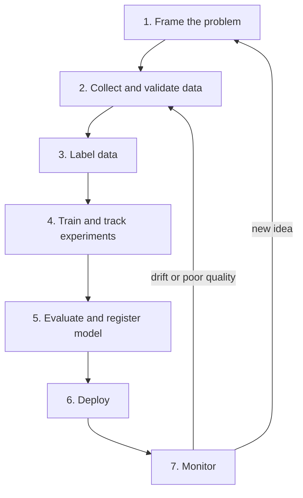

# ML Lifecycle and Problem Framing

A cricket team does not win a tournament with one good over. It needs practice, selection, fitness, and a plan for every match. A machine learning (ML) system is similar. The model is one player. The system around it decides whether you win in production.

## What it is

The **ML lifecycle** is the full loop of work needed to take an ML idea to a live system and keep it healthy. Google describes the data science steps in this order:

1. Data extraction
2. Data analysis
3. Data preparation
4. Model training
5. Model evaluation
6. Model validation
7. Model serving
8. Model monitoring

The last step feeds the first. Monitoring tells you when a new round is needed. So it is a loop, not a line.

*Figure: The ML lifecycle is a loop. Monitoring sends you back to data and framing.*

## Why the pipeline matters more than the model

The 2015 paper "Hidden Technical Debt in Machine Learning Systems" (Sculley et al., Google) makes one point with a picture. Only a small fraction of a real-world ML system is ML code. The rest is the surrounding infrastructure: data collection, validation, serving, monitoring, and more. The paper says this surrounding infrastructure is "vast and complex".

Google's *Rules of Machine Learning* says the same thing in plain words. Most problems you face are engineering problems, not ML problems. This chapter is about that engineering.

## Problem framing

Before any code, frame the problem. Google's problem framing guide has two steps.

**Step 1: Check that ML is a good approach.** Understand the problem, find a clear use case, and understand the data.

**Step 2: Say it in ML terms.**
- Define the ideal outcome and the model's goal.
- Identify the model's output.
- Define success metrics.

*Example:* Swiggy-style delivery time. The ideal outcome is that customers see a time they can trust. The model output is a number of minutes. Success metrics could be the average error in minutes and the share of orders arriving later than promised. (This is an illustration, not a claim about how any company does it.)

## Should you even use ML?

Rule 1 in *Rules of Machine Learning* says: do not be afraid to launch a product without ML. A simple heuristic (a hand-written rule) can get you part of the way. Rule 4 says the first model should be simple. Most of the early work is getting the infrastructure right.

| Situation | Better start |
|---|---|
| No data yet | A rule or manual process, while you collect data |
| Clear rule that works well enough | Keep the rule. Use it as your baseline |
| Data exists and rules are getting messy | Simple ML model |
| Simple model plateaus and gains are worth the cost | More complex model |

A heuristic is also your **baseline**. If your model cannot beat it, the model is not ready.

## Two kinds of metrics

- **Offline metric:** measured on saved data, like accuracy or error.
- **Business metric:** measured in the real product, like orders completed or fraud losses.

An offline metric can improve while the business metric does not. Decide both before you train. Rule 39 in the same guide says launch decisions are a proxy for long-term goals, and the easy launches are when all metrics get better or at least do not get worse.

## In the AI era

Large language models (LLMs) make "try a prompt first" a cheap baseline for many text tasks. The same discipline applies: write down the success metric, build a small baseline, and then decide if a heavier solution is worth it. Predictive ML with tabular data (fraud, pricing, ETA, ranking) still runs on the pipeline ideas in this chapter.

## Common mistakes

- Starting with a complex model before the data pipeline works.
- No baseline, so nobody knows if the model helps.
- Choosing a metric that is easy to compute but unrelated to the business goal.

> [!TIP]
> **Key takeaways**
> - The lifecycle is a loop: frame, data, train, evaluate, deploy, monitor, repeat.
> - Most of a real ML system is not the model. It is the pipeline and infrastructure around it.
> - Frame the problem first, set a heuristic baseline, and pick offline and business metrics before training.
