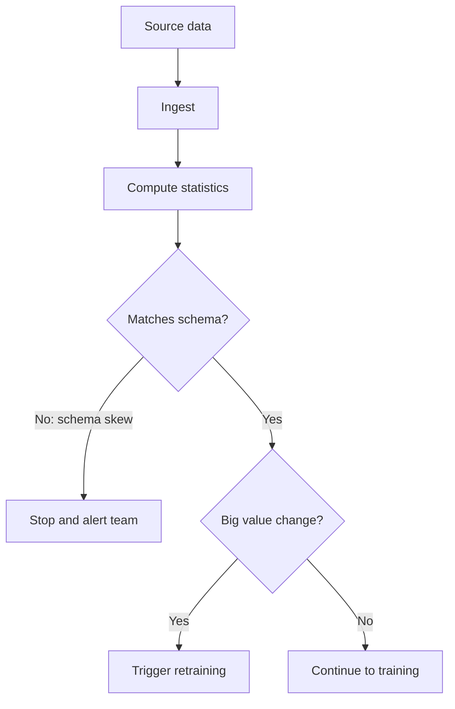

# Data Ingestion, Validation and Versioning

If bad rice enters the kitchen, no chef can save the biryani. In ML, bad data enters silently, and the model still runs. So you check the data at the gate.

## What it is

Three jobs sit at the start of every ML pipeline:

- **Ingestion:** pull data from source systems into one place.
- **Validation:** check that the data looks as expected before you train on it.
- **Versioning:** record exactly which data produced which model.

## Ingestion

Data usually arrives in one of two ways:

- **Batch:** files or tables from a database, warehouse or object storage, read on a schedule.
- **Streaming:** events from a log such as Kafka, read continuously.

For storage and queue basics, see [Chapter 2](../../module-1/02-storage.md). One warning from *Rules of Machine Learning* (Rule 6): when you copy an old pipeline for a new product, it may silently drop data the new product needs. Its example is a pipeline that dropped older posts. Also, if you log only what users saw, you lose the negative examples.

## Validation

**TensorFlow Data Validation (TFDV)** is an open-source library from the TFX project. It shows a clear pattern that most tools follow:

1. Compute **statistics** of the data.
2. Infer a **schema**: which features exist, their types, how often they appear, and allowed values.
3. Check new data against the schema and report **anomalies**.

TFDV advises that you review the inferred schema and refine it, because a machine-made schema may miss domain knowledge.

```python
import tensorflow_data_validation as tfdv

stats = tfdv.generate_statistics_from_dataframe(train_df)
schema = tfdv.infer_schema(stats)

new_stats = tfdv.generate_statistics_from_dataframe(new_df)
anomalies = tfdv.validate_statistics(new_stats, schema)
print(anomalies)  # an Anomalies protocol buffer
```

TFDV can also compare two datasets. A **skew** check compares training and serving data. A **drift** check compares one day of training data with the next. It reports an L-infinity distance for categorical features, or Jensen-Shannon divergence for both numeric and categorical features, against a threshold you set.

## What to do when validation fails

Google's MLOps guide separates two cases:

| Problem | Meaning | Action |
|---|---|---|
| **Schema skew** | Unexpected, missing or out-of-range features | Stop the pipeline. Humans must investigate |
| **Value skew** | Statistical properties changed a lot | Trigger retraining |


*Figure: A validation gate decides whether the pipeline stops, retrains or continues.*

## Versioning

A model is only reproducible if you can get back the exact data. A common approach is **DVC (Data Version Control)**. DVC stores a small metadata file (a `.dvc` file) in Git. The file holds the hash and path of your data. The data itself lives in a cache and in remote storage, such as an S3 bucket. Git history then tracks data history along with code history.

Other teams use dated snapshots in object storage, or table versions in a warehouse. The principle is the same: every training run should record an exact data reference.

## Common mistakes

- Validating only the schema, not the value distributions.
- Alerting on every tiny change, so people ignore the alerts.
- Training on "latest" data with no snapshot, so you cannot reproduce the model later.

## In the AI era

The same gate applies to data for LLM fine-tuning and retrieval pipelines. Check format, duplicates and sensitive data before it goes in. See [Chapter 7](../../module-3/07-rag-architectures.md) for ingestion in RAG systems.

> [!TIP]
> **Key takeaways**
> - Validate data at the gate: statistics, schema, anomalies, then skew and drift checks.
> - Schema problems should stop the pipeline. Large value changes can trigger retraining.
> - Version your data so any model can be traced to the exact data that made it.
