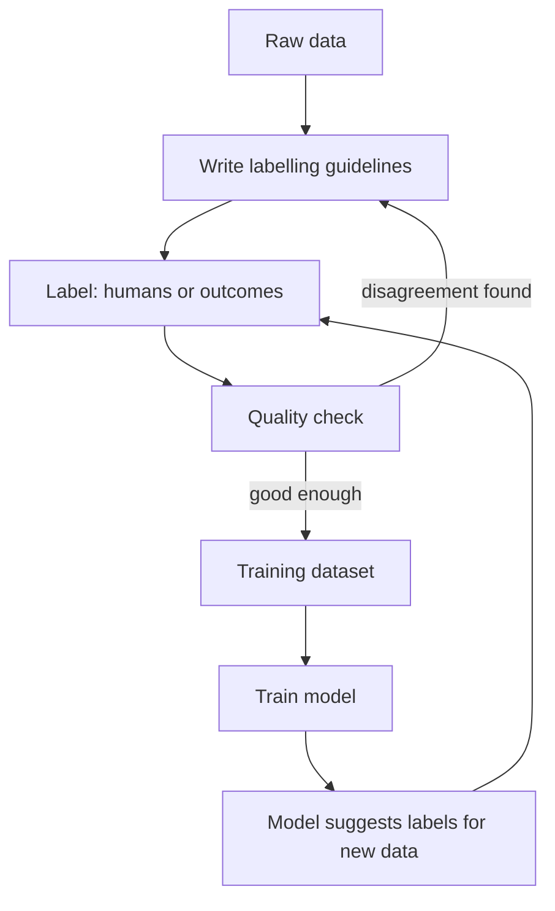

# Data Labelling

A model learns from examples with answers. The answer is the **label**: "this transaction was fraud", "this photo shows a dosa", "this order arrived in 31 minutes". Wrong labels teach wrong lessons.

## What it is

Labelling is the work of attaching the correct answer to each training example. It applies to **supervised learning**, where the model learns from examples that have answers. Where the labels come from is a design decision, and it shapes the whole pipeline.

## Where labels come from

| Source | Example | Good | Watch out |
|---|---|---|---|
| **Human annotators** | Staff mark support tickets as "billing" or "delivery" | Clear and controlled | Slow, costly, people disagree |
| **System outcomes** | Did the order arrive late? Was the loan repaid? | Free and large scale | Often arrives late |
| **User behaviour** | Click, purchase, skip | Large scale, fresh | A noisy proxy for what you really want |
| **Model-assisted** | A model suggests labels, humans review | Faster than starting from zero | The model's mistakes can bias reviewers |

Label Studio, an open-source labelling tool, supports the last row. You connect an ML backend to pre-label tasks, and annotators review or correct the suggestions.

## How the labelling loop works

*Figure: Labelling is a loop. Quality checks improve the guidelines, and the model can help with new data.*

## Label quality

Labels are not perfect, even in famous datasets. A 2021 study (Northcutt, Athalye and Mueller) found label errors of at least 3.3% on average across 10 widely used test sets. It also found at least 6% in the ImageNet validation set. So do not assume labels are clean.

Practical steps:

- Write clear **guidelines** with examples of edge cases.
- Let two or more people label a sample and compare. Frequent disagreement is a signal that the guideline is unclear.
- Keep a small **gold set** of examples with trusted answers, and use it to check annotators and your model.
- Use clean labels for the **test set** at least, since it decides whether you ship.

## Delayed and missing labels

Many real labels arrive late. A loan default shows up months later. A fraud chargeback can take days. The Google ML Test Score paper notes that it is often not possible to know the correct labels even shortly after serving time, which makes live quality measurement difficult.

This has two effects on pipeline design:

- Training data is always a little old. Plan for it.
- Monitoring cannot rely on accuracy alone. You also watch input and prediction drift as early signals (see the monitoring page in this chapter).

## Feedback loops

If the model decides what users see, the user clicks depend on the model. Then your new labels reflect the old model's choices. The Sculley et al. paper lists "hidden feedback loops" among ML-specific risks. As a simple habit, log which model version made each decision. Then you can study how the model changed the data it later learns from.

## In the AI era

LLMs are now used to draft labels for text tasks. This can save time, but verify it on a human-labelled gold set before trusting it. An unchecked model-made label is a guess, not ground truth.

> [!TIP]
> **Key takeaways**
> - Labels come from humans, system outcomes, user behaviour, or model suggestions. Each has its own trade-off.
> - Label errors are common. Use guidelines, agreement checks, and a trusted gold set.
> - Labels often arrive late. Design training and monitoring for that delay.
