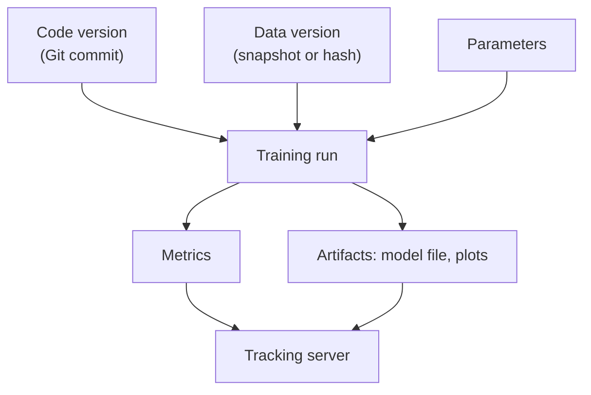

# Training and Experiment Tracking

You tried 40 versions of a model last month. Today your manager asks: "Which one is in production, and how was it trained?" If the answer lives in someone's notebook, you have a problem.

## What it is

**Training** fits a model to data. **Experiment tracking** records every attempt: the code, data, settings and results. Together they make training a repeatable engineering step, not a one-time art.

## Split the data correctly

Google's Machine Learning Crash Course gives the standard three sets:

| Set | Purpose |
|---|---|
| **Training** | The model learns from this |
| **Validation** | You compare versions and tune settings |
| **Test** | One final check on unseen data, after you finish choosing |

Three cautions from the same course and from *Rules of Machine Learning*:

- **Do not reuse the test set again and again.** If you keep adjusting the model based on test results, the test set stops being an independent check.
- **Remove duplicates** that appear in both training and test data. Otherwise the model is tested on examples it has already seen.
- **Apply the same transformations** to training, test and real-world data.

Rule 33 adds a point for systems that predict the future: test on data gathered *after* the training data, not only on a random holdout. A random split can look better than real life.

## Track every experiment

**MLflow Tracking** is a widely used open-source tool for this. It records:

- **Parameters:** inputs like learning rate.
- **Metrics:** numbers like loss or accuracy.
- **Artifacts:** output files such as model weights or plots.
- **Runs:** one execution of your code.
- **Experiments:** named groups of runs for one task.

```python
import mlflow

with mlflow.start_run():
    mlflow.log_param("lr", 0.001)
    # ... train and evaluate here ...
    val_loss = 0.123  # placeholder value
    mlflow.log_metric("val_loss", val_loss)
```

Without a configured server, this writes to a local `mlruns` folder. For a team, you would use a shared MLflow tracking server instead.


*Figure: A run links code, data and parameters to results, so the model can be reproduced.*

## What to log

Log enough to rebuild the model without asking anyone:

- Git commit of the training code
- Data version reference (see the data page)
- Parameters and library versions
- Metrics on validation and test sets, including per-slice results (for example by city or device type)
- The trained model file

The Google ML Test Score paper lists "training is reproducible" among its infrastructure tests. It also says model specification code should be reviewed and checked in to a repository. Responders need to know the exact code that produced a model when something breaks in production.

## Training-serving skew

Training code and serving code can quietly compute a feature in two different ways. This is **training-serving skew**. Rule 32 says to reuse code between training and serving. Rule 29 says to log the features used at serving time and use them for training. [Chapter 5](../05-feature-stores.md) shows how feature stores help.

## Common mistakes

- Tuning against the test set until it looks good.
- Reporting only one overall number, which hides failures on a segment.
- Training in a notebook with no saved code, data or settings.

## In the AI era

The same tracking idea now covers fine-tuning runs and prompt experiments: store the base model, data, settings and evaluation results together. Evaluation depth for LLM systems is in [Chapter 12](../../module-5/12-evaluation-safety.md).

> [!TIP]
> **Key takeaways**
> - Keep a clean test set, remove duplicates, and test on newer data when predicting the future.
> - Track code, data, parameters, metrics and artifacts for every run.
> - If you cannot reproduce a model, you cannot safely fix or improve it.
