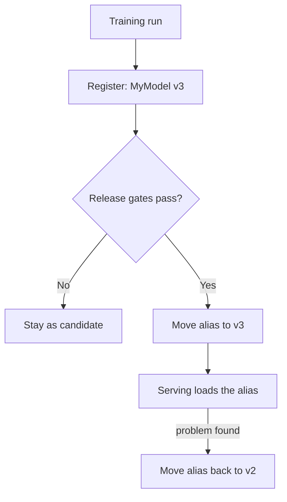

# Model Registry and Release Gates

A trained model file sitting in a folder called `final_v2_NEW` is not a release. A release has a name, a version, a history and an approval.

## What it is

A **model registry** is a central catalogue of trained models that are candidates for production. It answers: which models exist, which version is live, who approved it, and how was it trained?

MLflow Model Registry is a common open-source example. Its main concepts are:

- **Registered model:** a named entry that holds versions.
- **Model version:** a numbered entry. The first registration is version 1, the next is version 2, and so on.
- **Alias:** a mutable, named pointer to a version. For example, `champion` can point to version 1 of `MyModel`.
- **Tags:** key-value labels, such as `validation_status: approved`.
- **Lineage:** each version links back to the run that produced it.

## How it works

Your serving system does not hard-code "version 7". It asks for the model behind an alias. To change the live model, you move the alias to another version. To roll back, you move it back.

```python
import mlflow
from mlflow import MlflowClient

mlflow.register_model(model_uri="<YOUR_MODEL_URI>", name="MyModel")  # step 1: register

client = MlflowClient()
client.set_registered_model_alias("MyModel", "champion", 2)  # step 2: set alias

model = mlflow.pyfunc.load_model("models:/MyModel@champion")  # step 3: serve by alias
```

The URI form `models:/<model-name>@<alias>` comes from the MLflow documentation. The `pyfunc` flavour is a generic loader. Use the flavour that matches how you saved your model.


*Figure: Release is a controlled move of an alias, and rollback is the same move in reverse.*

## Release gates: model validation

Google's MLOps guide splits validation into two parts.

**Offline validation** (before real traffic):
- Evaluate on a test set.
- Compare against the current production model or a baseline.
- Check that performance is consistent across data segments.
- Confirm the model works with the infrastructure and API.

**Online validation** (with real traffic): run a canary or A/B test before the model serves everyone. See the deployment strategies page.

The ML Test Score paper adds practical tests: validate model quality before serving, and make sure you can roll back quickly and safely to a previous serving version.

## What a registry entry should hold

| Item | Why |
|---|---|
| Model file and version number | The thing you deploy |
| Link to training run, code and data | Reproduce or audit it |
| Evaluation metrics, including per-segment | Decide if it is better than the current model |
| Approval status | Who allowed it into production |
| Input and output format (signature) | Serving code knows what to send |

Google's guide also says a metadata store keeps pointers to previous models so you can roll back, and stores evaluation metrics for comparison.

## Common mistakes

- Overwriting the production model file in place, with no previous version to return to.
- Comparing the new model only with a fixed number, not with the current production model.
- Approving on one overall metric while one customer group gets worse results.

## In the AI era

LLM applications also have things to version: prompts, adapters, and the base model name. Treat them like registry entries so you can compare and roll back. The wider evaluation story is in [Chapter 12](../../module-5/12-evaluation-safety.md).

> [!TIP]
> **Key takeaways**
> - A registry gives every model a version, lineage, metrics and an approval state.
> - Serve by alias, so release and rollback are a pointer change.
> - Gate releases with offline validation against the current model, then online validation with real traffic.
