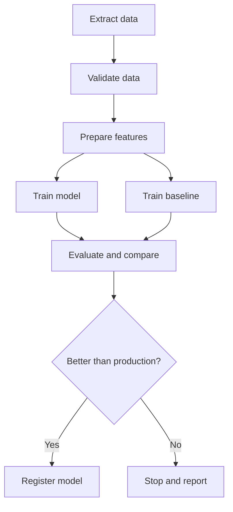

# Pipeline Orchestration

Think of a thali kitchen at lunch rush. Rice must cook before it is plated. Dal and sabzi can cook in parallel. If the gas stops, someone must know which dishes were affected. An orchestrator is that kitchen manager for your ML steps.

## What it is

**Orchestration** means running pipeline steps in the right order, on a schedule or a trigger, with retries and a record of what happened. Instead of one long script, you define a graph of small steps.

Both Apache Airflow and Kubeflow Pipelines model a workflow as a **DAG** (Directed Acyclic Graph). "Directed" means arrows have a direction. "Acyclic" means there are no loops. Each node is a task, and each arrow says "this must finish first".

## How it works

*Figure: A training pipeline as a DAG. Independent steps can run in parallel.*

## Two common tools

| | Apache Airflow | Kubeflow Pipelines (KFP) |
|---|---|---|
| **Main idea** | General workflow platform. It can orchestrate anything | ML workflows in containers on Kubernetes |
| **A step is** | A task: an operator, a sensor, or a Python function with `@task` | A component that runs as one container |
| **Strengths** | Scheduling, many integrations, data pipelines | Passing artifacts between steps, caching, ML focus |
| **Key parts** | Scheduler, executor, workers, metadata database | Python SDK, compiled YAML, a compatible backend |

From the official docs: Airflow's scheduler starts scheduled workflows and hands ready tasks to the executor, and a metadata database (usually PostgreSQL or MySQL) stores the state of DAGs and tasks. KFP lets you write pipelines in a Python SDK, compile them to YAML, and submit them to a compatible backend, such as the open-source KFP backend or Google Cloud Vertex AI Pipelines. KFP can also reuse results of earlier steps through caching, which saves compute.

Other orchestrators exist. The choice depends on your platform and team. The ideas below stay the same.

## What triggers a pipeline run

Google's MLOps guide lists five triggers:

1. **On demand:** someone runs it manually.
2. **On a schedule:** daily, weekly or monthly, depending on how often labelled data arrives and how fast patterns change.
3. **On new training data:** when new data becomes available.
4. **On performance degradation:** when quality visibly drops.
5. **On data distribution change:** when feature distributions shift, suggesting the model is stale.

Start with a schedule. It is the simplest and easiest to reason about. Add the others when monitoring is mature.

## Designing good pipeline steps

These habits come from general distributed-systems practice (see [Chapter 3](../../module-1/03-reliability.md)):

- **Small steps with clear inputs and outputs.** Easier to test, cache and retry.
- **Idempotent steps.** Running a step twice should give the same result and no duplicate side effects.
- **Pass references, not data.** Pass a path or table name between steps, not gigabytes in memory.
- **Record metadata.** Google's guide says a metadata store records pipeline versions, run times, parameters and artifact locations, and lets a failed pipeline resume from the last completed step.
- **Same pipeline for experiment and production.** Google's Level 1 description says experimentation and production use the same pipeline implementation. This reduces surprises.

## Common mistakes

- One giant script that cannot be resumed from the middle.
- Hard-coded paths and dates, so reruns overwrite old results.
- A pipeline that fails silently. Alert on failure and on "did not run".

## In the AI era

Agent workflows have a similar need for ordered steps, retries and state, but they decide the next step at run time. See [Chapter 8](../../module-4/08-agentic-architectures.md). Classic ML pipelines stay as fixed DAGs, which makes them easier to audit.

> [!TIP]
> **Key takeaways**
> - An orchestrator runs a DAG of small steps with order, retries, schedules and a run record.
> - Airflow is a general workflow tool. Kubeflow Pipelines is built for containerised ML steps.
> - Begin with scheduled retraining, then add data-based and performance-based triggers.
