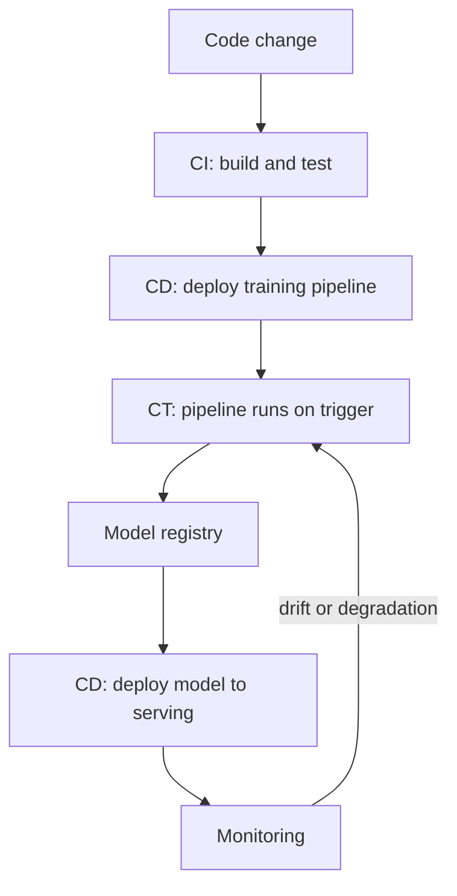

# CI, CD and CT for ML, and MLOps Maturity

In normal software, you test code and ship it. In ML, the code can be the same and the system can still get worse, because the data changed. So ML adds a third automation: retraining.

## What it is

Google's MLOps guide defines three terms:

- **CI (Continuous Integration):** beyond testing code, it also tests and validates data, data schemas and models.
- **CD (Continuous Delivery):** it delivers a whole training pipeline, which then deploys the prediction service. You ship a pipeline, not just one package.
- **CT (Continuous Training):** the system retrains and serves models automatically. This is unique to ML.

**MLOps** (Machine Learning Operations) is the practice of doing all this reliably, in the way DevOps does for software.

## How it works

*Figure: Code changes go through CI and CD. Monitoring signals trigger CT without any code change.*

Google lists these stages: experimentation, pipeline CI, pipeline CD, automated triggering, model CD and monitoring. The output of experimentation is pipeline source code. The output of automated triggering is a trained model pushed to the registry.

## What CI tests in ML

From Google's guide:

- Unit tests for feature engineering logic.
- Unit tests for model methods, such as one-hot encoding.
- Check that training converges: loss goes down, and the model can overfit a few sample records.
- Check that training does not produce NaN (not a number) values.
- Check that each component produces its expected artifacts.
- Integration tests between pipeline components.

The ML Test Score paper (Breck et al., Google) offers 28 tests in four areas: data, model, infrastructure and monitoring. It scores each test half a point if run manually and a full point if automated. The final score is the minimum across the four areas, so a team cannot hide weak monitoring behind strong data tests.

## MLOps maturity levels

Google's guide describes three levels:

| Level | Name | What is automated |
|---|---|---|
| **0** | Manual | Every step is manual and notebook-driven. Models are handed to engineers. No CI/CD. Releases are rare. No active monitoring |
| **1** | ML pipeline automation | Training pipeline runs automatically (CT). Adds data validation, model validation, triggers and metadata. Feature store is optional |
| **2** | CI/CD pipeline automation | Adds automated build, test and deployment of pipeline code changes, with registry, metadata store and orchestrator |

Level 0 has a known risk: the hand-over from data scientist to engineer can cause training-serving skew.

Microsoft's Azure Architecture Center uses a five-level model: no MLOps, DevOps but no MLOps, automated training, automated model deployment, and full MLOps automated operations. It stresses that real organisations often show traits of more than one level, so treat levels as a continuum.

## Do not over-build

You do not need Level 2 on day one. *Rules of Machine Learning* says to keep the first model simple and get the infrastructure right. A sensible path:

1. Make training reproducible and tracked.
2. Add data validation and model validation gates.
3. Schedule retraining.
4. Automate deployment with canary and rollback.
5. Add monitoring-based triggers.

## Common mistakes

- Automating retraining without validation gates. A bad model then ships automatically.
- Testing only code and ignoring data and model checks.
- Chasing a maturity level for its own sake instead of fixing the biggest pain.

> [!TIP]
> **Key takeaways**
> - CI tests code, data and models. CD ships a pipeline. CT retrains automatically.
> - Maturity grows from manual notebooks, to automated training, to automated CI/CD.
> - Add automation step by step, and always keep validation gates before release.
