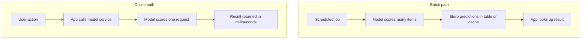

# Batch vs Online Prediction

A dabbawala does not cook your lunch when you ask. The food is ready in the morning and delivered on a fixed route. A tandoor restaurant cooks when you order. Both serve food, but the time, cost and freshness are very different. Prediction works the same way.

## What it is

- **Batch prediction (static or offline inference):** the model predicts for a known set of inputs ahead of time and stores the results. Applications simply look them up.
- **Online prediction (dynamic or real-time inference):** the model predicts on demand, when a client sends a request.

Google's Machine Learning Crash Course uses the terms static and dynamic inference for these two.

## How it works

*Figure: Batch computes before the request. Online computes during the request.*

## Trade-offs

| | Batch | Online |
|---|---|---|
| **Advantage** | Inference cost is less of a worry. You can check predictions before pushing them | Can score any new item as it arrives, including rare inputs |
| **Disadvantage** | Serves only cached predictions. Uncommon inputs may get no answer. Update delay is often hours or days | Compute-heavy and latency-sensitive. This can limit model complexity. Monitoring needs more effort |
| **Freshness** | As old as the last run | Uses the latest input |
| **Failure mode** | A job fails and results go stale | Service is slow or down, and user feels it |
| **Typical fit** | Nightly recommendations, churn lists, email campaigns | Fraud check during a payment, search ranking, ETA at checkout |

The advantage and disadvantage rows follow Google's crash course. The "typical fit" row is an illustration, not a statement about any specific company.

## Choosing between them

Ask these questions:

1. **Does the prediction need data that exists only at request time?** (For example, the cart the user just built.) If yes, you need online.
2. **How fresh must it be?** Hours old is fine for a weekly newsletter. It is not fine for a payment risk check.
3. **How many possible inputs are there?** If the set is small and known, precompute it. If it is huge or open-ended, go online.
4. **What is the latency budget?** Online models must answer within it. Chapter 5 covers this.

Many systems mix both. A batch job precomputes results for common cases, and an online model handles the rest. A two-stage recommender can precompute candidates in batch and rank them online ([Chapter 5](../05-feature-stores.md)).

## Where the model runs

Google's MLOps guide notes that serving targets include a REST microservice for online prediction, an edge or mobile device, or a batch prediction system. The pipeline should produce an artifact that suits the target.

## Pipeline impact

- Batch jobs fit naturally inside the orchestrator as one more DAG step.
- Online serving needs autoscaling, timeouts and health checks. See [Chapter 3](../../module-1/03-reliability.md).
- Whichever you choose, keep feature code the same in training and serving to avoid skew.

## Common mistakes

- Choosing online "because it feels modern", when a nightly job would meet the need at lower cost.
- Using stale batch scores where freshness matters.
- Forgetting a fallback when the online model is slow or down.

> [!TIP]
> **Key takeaways**
> - Batch predicts ahead and stores results. Online predicts on each request.
> - Batch is cheaper and checkable but stale. Online is fresh but latency-sensitive and harder to monitor.
> - Choose by freshness, input space, and latency, and consider a hybrid.
