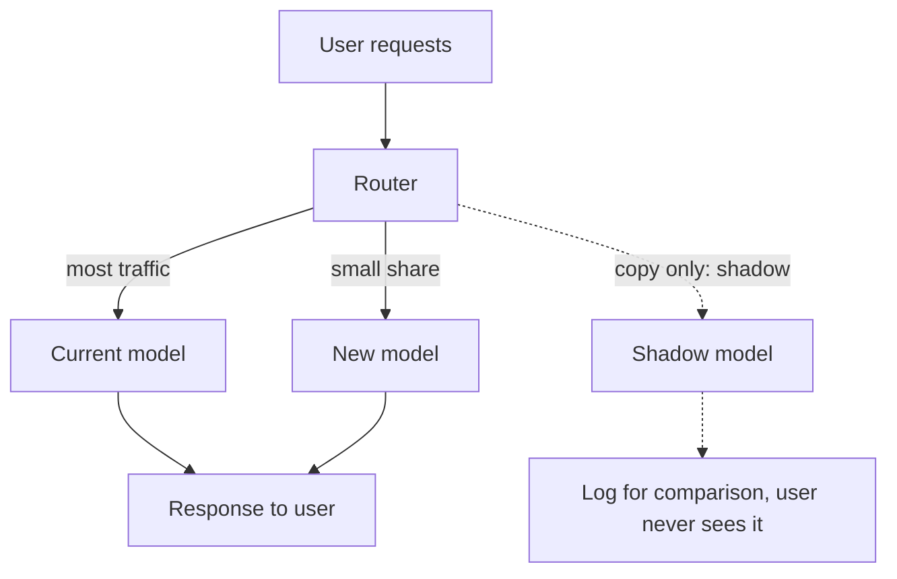

# Deployment Strategies: Shadow, Canary, A/B

A new model that scored well offline can still fail on real users. Think of the IRCTC Tatkal rush: a feature that works in testing may break under real traffic. So you release a model in steps, and keep a way back.

## What it is

A **deployment strategy** is a way to move real traffic from the current model to a new one while limiting damage. The AWS Well-Architected Machine Learning Lens names four: blue/green, canary, A/B and shadow.

## The four strategies

**Shadow.** The new version runs alongside the old one. Input data goes through both. The old version serves users. The new one is used only for testing and analysis. SageMaker's shadow tests, for example, route a copy of live requests to the new model and let you log its responses for comparison.

**Canary.** The new version goes to a small group of users while the others stay on the old version. If it looks good, you roll it out gradually.

**A/B testing.** You send a defined portion of traffic to the new model and the rest to the old one. AWS describes it as similar to canary but with larger user groups and a longer time scale, typically days or even weeks. The goal is to measure a business metric, not only to check safety.

**Blue/green.** Two identical production environments exist. Blue is the existing one. Green is the new one. After testing on green, traffic is directed to it. SageMaker's blue/green deployment can shift traffic all at once, as a canary, or linearly.

*Figure: Canary sends real traffic to the new model. Shadow only copies traffic and logs the result.*

## When to use what

| Strategy | Users see new model? | Best for | Main cost |
|---|---|---|---|
| **Shadow** | No | Checking a new model or infrastructure on real inputs with no user risk | Extra compute. No direct user-impact data |
| **Canary** | A few | Catching crashes, latency and obvious quality problems early | Needs good alerts and a quick rollback |
| **A/B** | Yes, by design | Proving the model improves a business metric | Takes time and enough traffic |
| **Blue/green** | Gradually or all | Switching with fast return to the old fleet | Two fleets running at once |

With SageMaker's multi-step or baking-period updates, both fleets are billed for the whole update. Other platforms differ, so check yours.

## Guardrails and rollback

SageMaker's deployment guardrails add a **baking period**, where the new fleet is monitored, plus CloudWatch alarms. If an alarm trips, traffic returns to the old fleet. The idea is general: define the alarm *before* the release.

The ML Test Score paper has related tests: models should be tested with a canary process, and they should be quick and safe to roll back to a previous serving version. Pair this with the registry alias move from the registry page.

## A sensible release path

1. Pass offline validation against the current model.
2. Run in shadow if the risk is high or the infrastructure is new.
3. Canary to a small share. Watch latency, errors and prediction distribution.
4. A/B test if you must prove business impact.
5. Roll out fully. Keep the old version ready for rollback.

## What to watch during rollout

- Technical: latency, errors, timeouts.
- Prediction behaviour: does the score distribution look like the old model's?
- Business: the metric you defined in problem framing.
- Segments: one group may suffer while the average looks fine.

## Common mistakes

- Judging an A/B test after a few hours of data.
- No rollback plan, or a rollback that needs retraining.
- Watching only average latency and missing the slow tail.

> [!TIP]
> **Key takeaways**
> - Shadow tests without user risk. Canary limits damage. A/B proves business value. Blue/green gives a fast switch back.
> - Define alarms and rollback before the release, not after.
> - Watch technical, prediction and business metrics, and look at segments.
