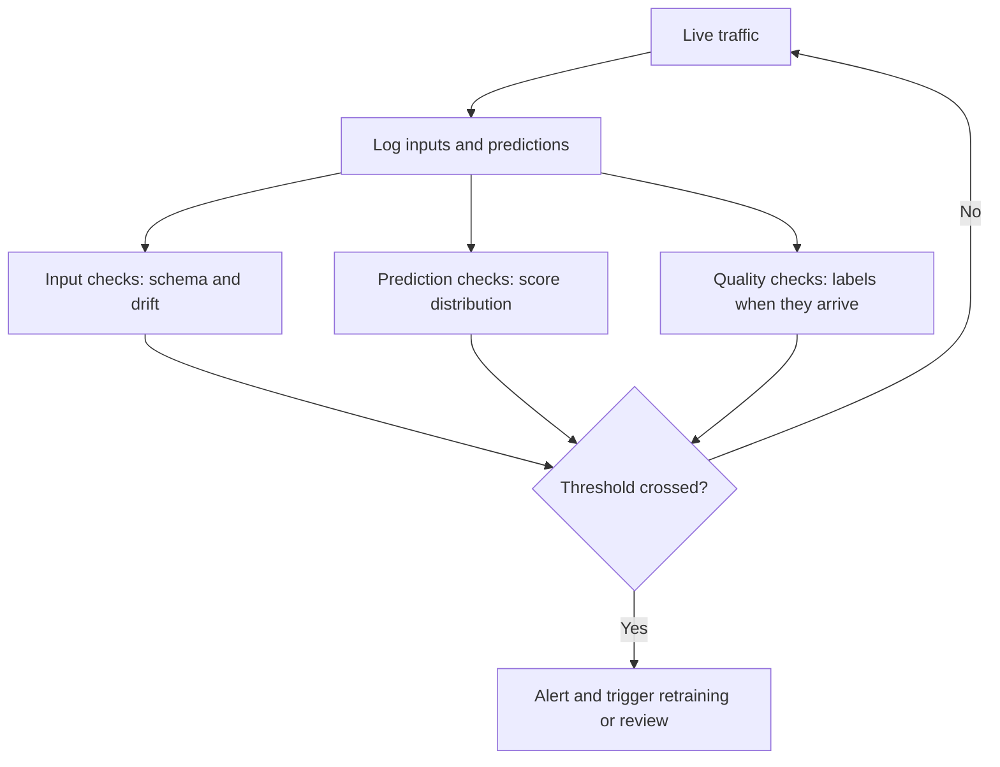

# Drift and Monitoring

A model is like a cricket commentator's memory of last season. It works well until the players, the pitch and the rules change. Then it keeps talking confidently and is wrong. ML models do not crash when the world changes. They just get worse quietly.

## What it is

**Monitoring** means watching the system in production to catch problems early. **Drift** is the main ML-specific problem: the world moves away from what the model learned.

## Kinds of change

| Term | Meaning | Example (illustration) |
|---|---|---|
| **Data drift** (feature drift) | The distribution of incoming inputs changes compared with training data | A new city launch brings very different order sizes |
| **Concept drift** | The relationship between inputs and the target changes, so learned patterns no longer hold | Customer behaviour changes after a price change |
| **Schema skew** | Serving data no longer matches the training schema | A field format changes upstream |
| **Feature skew** | Feature code differs between training and serving | Two code paths compute "age" differently |

Evidently, a monitoring library vendor, notes that data drift often comes with concept drift but can occur without it. Concept drift can be gradual (the most common), sudden, or recurring (seasonal patterns such as festival sales).

## What to monitor

Google's Machine Learning Crash Course suggests watching more than the headline metric:

- Performance on **data slices**, not only overall.
- **Real-world outcomes**, such as user-reported results.
- **Numerical stability**: NaN or Inf values in weights and outputs.
- Performance by code, model and data version, plus latency percentiles and queries per second.
- **Model age**: set an alert if the model has not been retrained within a threshold.

Rule 10 in *Rules of Machine Learning* warns about silent failures, such as a stale table or a drop in feature coverage. Rule 8 says to measure how fast performance decays as the model ages. That tells you how often to retrain.

*Figure: Three kinds of checks feed one decision: alert, retrain or keep watching.*

## When labels are late

You often cannot compute accuracy right away, because the true labels arrive later (see the labelling page). Evidently suggests label-free signals:

- **Prediction drift:** compare today's predicted classes or probabilities with a reference period.
- **Input drift:** compare feature distributions.
- **Correlation changes:** track how features relate to predictions.
- **Proxy metrics:** for example the click rate on a recommendation block, or categories never seen in training.

Statistical tools include the Kolmogorov-Smirnov test, chi-square test, Wasserstein distance and Population Stability Index (PSI). With many features, track the share of drifted features instead of every feature separately.

When labels do arrive, compute real quality and compare with the offline score.

## From alert to action

Not every drift needs retraining. Google's MLOps guide says large value changes in data can trigger retraining, while schema problems should stop the pipeline so people can investigate. A practical response order:

1. Check for a data bug or upstream change first.
2. If the data is correct and the world changed, retrain on recent data.
3. Validate the new model, then release it through canary.
4. If retraining does not help, revisit the features or problem framing.

This closes the lifecycle loop from the first page.

## In the AI era

LLM systems add new things to watch, such as token cost, answer quality and safety. The ideas of baselines, slices and drift still apply. Logs, metrics, traces and alerting in general are covered in [Chapter 11](../../module-5/11-observability.md).

## Common mistakes

- Monitoring only service health (CPU, latency) and not model quality.
- Setting drift thresholds so tight that alerts become noise.
- Having no reference window, so nothing to compare against.

> [!TIP]
> **Key takeaways**
> - Models degrade quietly. Data drift changes inputs, concept drift changes the input-output relationship.
> - Monitor slices, model age, input and prediction distributions, and real quality when labels arrive.
> - Investigate the cause before retraining, and release new models through the same gates.
