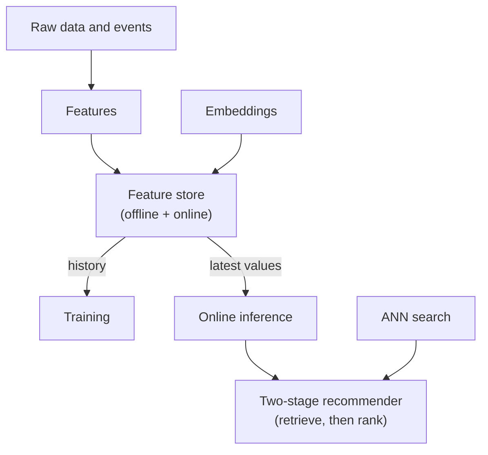

# Chapter 5: Feature Stores & Real-Time Inference

Think of a Swiggy-style delivery time estimate. The model does not see raw data like "rider GPS pings" or "order table rows". It sees a few clean numbers: distance, how busy the restaurant has been in the last 15 minutes, how many orders the rider is carrying. These numbers are called **features**.

Getting the right feature, at the right time, in a few milliseconds, is where many ML systems break. The model can be perfect, yet the product fails because the feature at serving time is different from the feature at training time, or because it arrives too late.

This chapter is about that plumbing: how features are defined, stored, kept consistent and served, and then how the model itself is served under a tight latency budget. It also covers embeddings and the two-stage recommender pattern, which powers search feeds, "videos for you" and "products you may like".

In the AI era this matters even more. Embeddings are now features. Retrieval is now a first step in RAG as well. The same ideas return in [Chapter 7](../module-3/07-rag-architectures.md) and [Chapter 14](../module-6/14-case-studies.md). The ML pipeline that produces models is covered in [Chapter 4](04-ml-pipelines.md).

*Figure: How the concepts in this chapter fit together.*

## What you will learn

- **What Is a Feature**: entities, timestamps and the three kinds of features.
- **Why Feature Stores Exist**: the problems they solve and their parts.
- **Offline and Online Stores**: two stores, two jobs, and the sync between them.
- **Training-Serving Skew**: why a good model can fail in production.
- **Point-in-Time Correctness**: how to build training data without leaking the future.
- **Streaming and Real-Time Features**: fresh features from event streams.
- **Model Serving Patterns**: batch, online and the servers that run models.
- **Latency Budgets and Tail Latency**: splitting 100 ms across the request path.
- **Embeddings**: vectors as features and as a way to measure similarity.
- **Two-Stage Recommenders and ANN Search**: retrieval, ranking and fast vector lookup.
