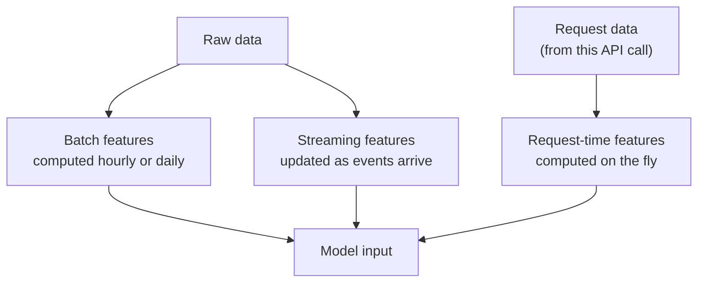

# What Is a Feature

A model is like a student: it can only answer from what you put on the question paper. A feature is one line on that paper.

## What it is

A **feature** is a measurable input to a model. It is usually computed from raw data. For example, raw data is a list of orders. A feature is "number of orders by this user in the last 7 days".

Every feature belongs to an **entity**: the thing the feature describes, such as a user, a driver, a product or a restaurant. The entity is found using a **key** (for example `user_id`).

Every feature value also has a **timestamp**: when this value was true. This timestamp is the secret behind most feature store ideas. A value with no time is dangerous, because you cannot tell if it was known at prediction time.

*Example* rows for a food delivery model:

| restaurant_id | event_timestamp | orders_last_15_min | avg_prep_minutes |
|---|---|---|---|
| R101 | 2026-11-02 19:00 | 12 | 14.5 |
| R101 | 2026-11-02 19:15 | 31 | 18.0 |
| R202 | 2026-11-02 19:00 | 4 | 9.0 |

The same restaurant has different values at different times. That is normal.

## How it works

Features can be grouped by how fresh they must be.

*Figure: Three ways a feature reaches the model.*

| Kind | Freshness | Example | Cost |
|---|---|---|---|
| Batch | Hours to a day old | User's average order value over 90 days | Cheap, simple |
| Streaming | Seconds to minutes old | Card transactions in the last 10 minutes | Needs stream processing |
| Request-time | Exact, at call time | Is the delivery address within 5 km of the restaurant? | Computed inside the request, so it adds latency |

Feast (an open-source feature store) supports the request-time idea through "on demand feature views". They transform existing features and request-time data into new features using Python logic. Feast marks this feature as Alpha in its docs.

## Trade-offs

- **Fresher is not always better.** A 90-day average does not need second-level updates. Pay for freshness only where the model gains from it.
- **Heavy features are best precomputed.** If a feature needs a big join or scan, do it in batch, not inside the request.
- **Every feature needs an owner and a definition.** "Active user" can mean three different things in three teams.

## In the AI era

Embeddings (lists of numbers learned by a model) are now common features too. We cover them in a later page. Features for LLM apps also include things like user profile, past conversation facts and retrieved documents. The same rules about freshness and timestamps apply.

> [!TIP]
> **Key takeaways**
> - A feature is a model input, tied to an entity and to a point in time.
> - Features come in three kinds: batch, streaming and request-time.
> - Choose freshness by need. Precompute whatever is expensive.
