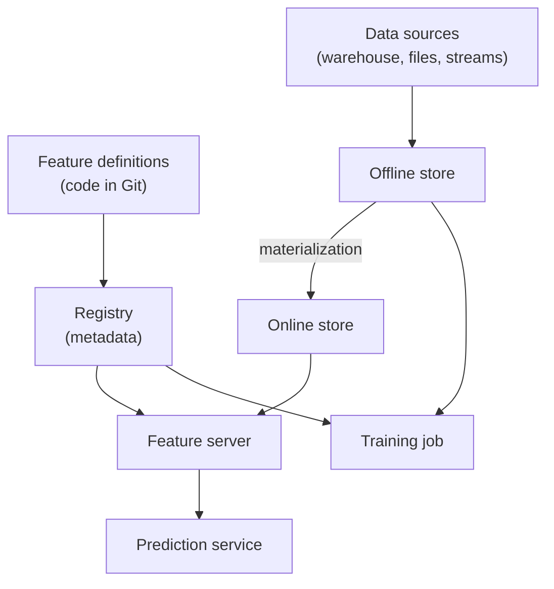

# Why Feature Stores Exist

Imagine every team in a company writing its own "total orders last 30 days" code. Three teams, three answers. Now the model trained with one answer is served with another. A feature store is the fix.

## What it is

Google Cloud's MLOps guide describes a feature store as a centralised repository where you standardise the definition, storage and access of features. It must support two kinds of access:

- **High-throughput batch access** for training and experiments.
- **Low-latency real-time access** for predictions.

The guide lists the benefits: discover and reuse existing features, keep one definition per feature, serve up-to-date values, and avoid training-serving skew by using the store as the data source for training and for serving.

## How it works

Take Feast, an open-source feature store, as one concrete example. Other products (managed or in-house) differ in details but follow a similar shape.

*Figure: Main parts of a feature store (Feast-style).*

| Part | Job |
|---|---|
| Feature definitions and registry | Feast says features are registered as code in a version-controlled repository and kept in a registry that users and services can access. |
| Offline store | Holds history. Used to build training data and for batch scoring. |
| Online store | Holds the latest value per entity for fast lookup. |
| Materialization | Copies feature values from batch sources into the online store. |
| Feature server | In Feast, a stateless REST API (built on FastAPI) that reads the online store and registry. Any language that can call HTTP can use it. |

A **feature service** in Feast groups features, usually one group per model version. This helps you track which features each model uses.

## Trade-offs

A feature store is not free. It is another system to run and keep healthy.

| Situation | Feature store worth it? |
|---|---|
| One model, one team, batch scoring only | Usually not needed. A well-tested SQL job is enough. |
| Many models sharing features | Yes. Reuse saves effort and avoids conflicting definitions. |
| Real-time predictions with features from history | Yes. You need the online store and sync. |

This table is a rule of thumb, not a law. Judge by how much pain skew and duplication cause you.

## Real-world note

Uber's engineers described their feature store, Palette, in an InfoQ talk. The speaker said managing features is one of the biggest bottlenecks in productising ML. He also said that sharing features across teams was a goal not yet achieved "to the extent that we'd like". So, even with a store, reuse needs trust and good tooling. Do not expect it for free.

## Common mistakes

- Treating the store as a dumping ground without owners or documentation.
- Building it before you have a second model or an online use case.
- Forgetting that applying a Feast feature service does not deploy any service by itself. The Feast docs state this clearly.

> [!TIP]
> **Key takeaways**
> - A feature store gives one definition of each feature for training and serving.
> - Main parts: registry, offline store, online store, materialization, feature server.
> - Adopt it when many models or real-time use cases need shared features, not before.
