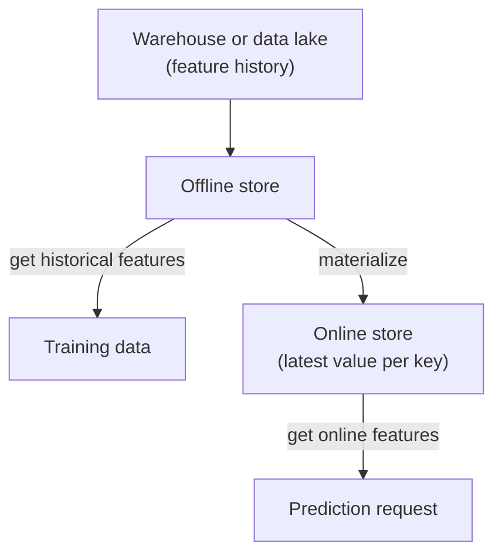

# Offline and Online Stores

A railway has two kinds of records. The archive of every ticket sold in the last ten years. And the live board on the platform showing the next train. Different needs, different systems.

## What it is

A feature store keeps the same features in two places:

- **Offline store**: history of feature values over time. Large, cheap, scanned in bulk. Used for training and batch scoring. Feast describes offline use as querying batch data through a compute engine such as a data warehouse.
- **Online store**: only the latest value per entity. Small, fast, read by key. Feast's docs say that only the latest feature values are stored there.

## How it works



*Figure: Offline store feeds training. Materialization feeds the online store.*

**Materialization** is the job that loads values from the batch source into the online store. It runs on a schedule (every hour, say). Feast supports `materialize` and `materialize-incremental`.

Here is a short sketch based on the Feast quickstart. Treat it as an outline; check the Feast docs for exact setup.

```python
driver = Entity(name="driver", join_keys=["driver_id"])

driver_stats_fv = FeatureView(
    name="driver_hourly_stats",
    entities=[driver],
    ttl=timedelta(days=1),
    online=True,
    source=driver_stats_source,   # a FileSource defined earlier
    schema=[Field(name="conv_rate", dtype=Float32)],
)

features = store.get_online_features(
    features=["driver_hourly_stats:conv_rate"],
    entity_rows=[{"driver_id": 1004}],
).to_dict()
```

Materialization is run from the command line:

```bash
feast materialize-incremental $CURRENT_TIME
```

The same feature view is used for training (`get_historical_features`) and for serving (`get_online_features`). That is how the two stores stay consistent in definition.

## Which database for the online store?

Feast lists many options, including Redis, DynamoDB, Cassandra, Bigtable, PostgreSQL and others. Uber's Palette used Hive offline and Cassandra online, as per the InfoQ talk. As an example of the speed class, AWS describes DynamoDB as a key-value and document database with single-digit millisecond performance. Other stores have their own claims; verify them for your workload.

| Question | Offline store | Online store |
|---|---|---|
| Holds | Full history | Latest value per key |
| Read pattern | Big scans and joins | Many small key lookups |
| Speed need | Jobs can take time | Must answer inside the request |
| Used by | Training, batch scoring | Live prediction |

## Trade-offs

- **Staleness.** The online value is as old as the last materialization. Hourly jobs mean values up to an hour old. For fresher values use streaming ([see later page](06-streaming-and-real-time-features.md)).
- **Cost.** Keeping every entity in a fast store (often memory-heavy) costs more. Keep only features the model really uses online.
- **Sync risk.** Two stores can drift apart if pipelines fail silently. Monitor freshness.

> [!TIP]
> **Key takeaways**
> - Offline store keeps history for training. Online store keeps the latest value for serving.
> - Materialization copies data from offline to online on a schedule.
> - Online freshness is limited by how often you sync.
