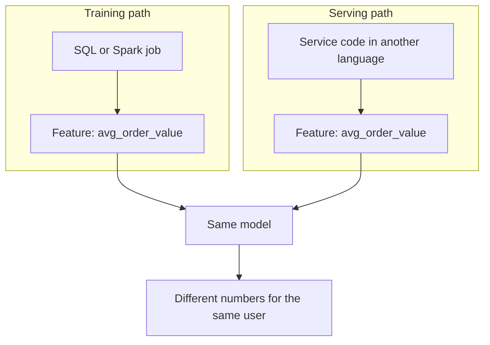

# Training-Serving Skew

Your model scores 92% in the lab and behaves badly on real traffic. Often the model is fine. The input is different.

## What it is

Google's *Rules of Machine Learning* defines **training-serving skew** as a difference between performance during training and performance during serving. It names three causes:

1. A discrepancy between how you handle data in the training and serving pipelines.
2. A change in the data between training time and serving time.
3. A feedback loop between your model and your algorithm.

This page focuses on the first two, because a feature store directly helps with them.

## How it works

Skew usually appears when two separate code paths build the "same" feature.

*Figure: Two code paths for one feature. Small differences become silent errors.*

*Example* of how it goes wrong (illustrative):

- Training code ignores cancelled orders. Serving code counts them.
- Training fills a missing value with 0. Serving fills it with the average.
- A user table is joined at training time, but its values change before serving.

The model never crashes. It just gives worse answers, and nobody gets an alert.

## Ways to reduce it

The Rules of ML give practical advice:

- **Rule 29**: the best way to train as you serve is to save the features used at serving time and use those logs for training. If you cannot log everything, log a small fraction to check consistency.
- **Rule 31**: if you join a table at training and serving time, the table may change in between. Logging features at serving time is the easiest fix. For slow-changing tables, hourly or daily snapshots help but do not fully solve it.
- **Rule 32**: reuse code between the training and serving pipelines where possible. The guide also advises against using different programming languages for the two.

A feature store applies these ideas in one place:

| Approach | How it reduces skew |
|---|---|
| One feature definition | Training and serving read the same feature view (Feast resolves feature services and references to the same feature views). |
| Shared transformation code | Uber's Palette talk says its transformer framework runs the same scoring function in the online and offline paths. |
| Logged serving features | You train on exactly what the model saw. |

Uber's speaker also said ad hoc feature computation causes skew that is "extremely hard to debug" and should be avoided.

## Trade-offs

Logging every feature of every request costs storage and may hold personal data. Sample, set retention limits and mask sensitive fields. For data privacy rules, see [Chapter 10](../../module-4/10-security-governance.md).

## Common mistakes

- Testing the model offline only. Always compare feature values from training and from live traffic.
- Assuming "same SQL" means same result. Time zones, null handling and rounding differ across engines.
- Ignoring skew until accuracy drops. Check the data first; see drift and monitoring in [Chapter 4](../04-ml-pipelines.md).

> [!TIP]
> **Key takeaways**
> - Skew means the model sees different inputs in training and in serving.
> - Main causes: two code paths for one feature, and data that changes in between.
> - Fix with one definition, shared code and logged serving features.
